<div align="center">

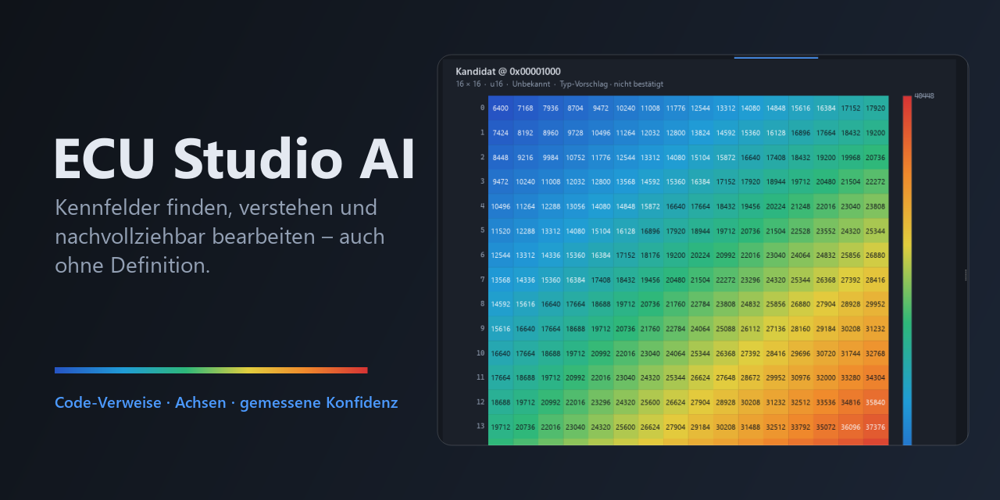

<br>

[](https://github.com/PCTestAdmin/ECU-Studio-AI/releases/latest)
[](https://github.com/PCTestAdmin/ECU-Studio-AI/releases)
[](https://github.com/PCTestAdmin/ECU-Studio-AI/actions/workflows/tests.yml)
[](https://github.com/PCTestAdmin/ECU-Studio-AI/commits/main)
<br>
[](#installation)
[](#entwicklung)
[](LICENSE)
[](https://github.com/PCTestAdmin/ECU-Studio-AI/stargazers)

## Kennfelder finden – auch ohne Definition.<br>Mit Beweis, nicht mit Bauchgefühl.

**ECU Studio AI** ist eine Open-Source-Kalibrier-Workbench für Motor- und Getriebesteuergeräte.<br>
Sie liest den Programmcode des Steuergeräts, findet Kennfelder samt Achsen und sagt dir bei jedem Fund,<br>
**wie sicher er ist – gemessen an echten Herstellerdaten.**

<br>

[](https://github.com/PCTestAdmin/ECU-Studio-AI/releases/latest)
&nbsp;
[](#in-aktion)
&nbsp;
[](docs/ECU_SUPPORT.md)
&nbsp;
[](docs/PROGRESS.md)

<sub>Kein Python nötig · Deutsch &amp; English · Updates mit Prüfsumme und Rollback · Die Originaldatei wird nie verändert</sub>

</div>

<details>
<summary><b>🇬🇧 English summary</b></summary>
<br>

**ECU Studio AI** is an open-source calibration workbench for engine and transmission control units (Windows, GPL-3.0).

- **Finds calibration maps without a definition** – from code references (C16x, TriCore, 68k, SH-2, HC11, 8051),
  record headers with axes, and structure analysis. Every candidate carries a *measured* confidence, not a guess.
- **Works with the definitions you have:** TunerPro XDF, ASAM A2L / DAMOS (with EPK software-ID check), RomRaider XML, CSV.
- **Edit safely:** hex, table, heatmap, 3D and curve views, ORI/MOD comparison, checksum verification and correction
  (only where the algorithm is proven on the original), flash preflight. The original file is never changed.
- **Measured, not promised:** e.g. Siemens MSD85 279 of 1026 maps found exactly at 81 % precision on held-out test
  data; all results per ECU in the [support matrix](docs/ECU_SUPPORT.md).
- **English interface:** *Einstellungen → Sprache / Language → English* (defaults to the system language).
- **Deliberately out of scope:** automatic "stage 1" tuning, disabling emission or protection functions, flash approval.

[⬇ Download for Windows](https://github.com/PCTestAdmin/ECU-Studio-AI/releases/latest) – portable ZIP or installer,
no Python needed. The rest of this page is in German.

</details>

---

## ⚡ Auf einen Blick

<table>
<tr>
<td width="33%" valign="top" align="center">

### 🔍 Findet
**Kennfelder, Kennlinien und Achsen**<br>
in unbekannten BIN-Dateien – aus den Adressen, die der Programmcode selbst lädt, aus Datensätzen mit Achsen
und aus der Struktur der Daten.

</td>
<td width="33%" valign="top" align="center">

### 🔬 Belegt
**Jeder Fund nennt seinen Beweis**<br>
und eine Trefferquote, die an Herstellerdefinitionen gemessen wurde – *gesichert*, *wahrscheinlich* oder
*Vermutung*. Kein Fund gibt sich als mehr aus, als er ist.

</td>
<td width="33%" valign="top" align="center">

### 🛡️ Schützt
**Bearbeiten ohne Risiko für das Original**<br>
Änderungen liegen als nachvollziehbare Ebene über der Datei, mit Preflight, Zwillings-Check, geprüften
Checksummen und Undo.

</td>
</tr>
</table>

<div align="center">

| **463** von 703 | **279** von 1026 | **0** | **6** | **650+** |
|:---:|:---:|:---:|:---:|:---:|
| Kennfelder exakt gefunden<br><sub>Bosch EDC17CP09 · Hersteller-A2L</sub> | Kennfelder exakt auf **Testdaten**<br><sub>Siemens MSD85 · nie zum Einstellen genutzt</sub> | Fehlalarme<br><sub>auf Zufallsdaten, gelöschtem Flash, Nullen</sub> | Definitionsformate<br><sub>XDF · A2L · DAMOS · RomRaider · CSV · Kennfeldpaket</sub> | automatische Tests<br><sub>bei jeder Änderung</sub> |

</div>

---

<a id="in-aktion"></a>

## 🎬 In Aktion

<p align="center">
  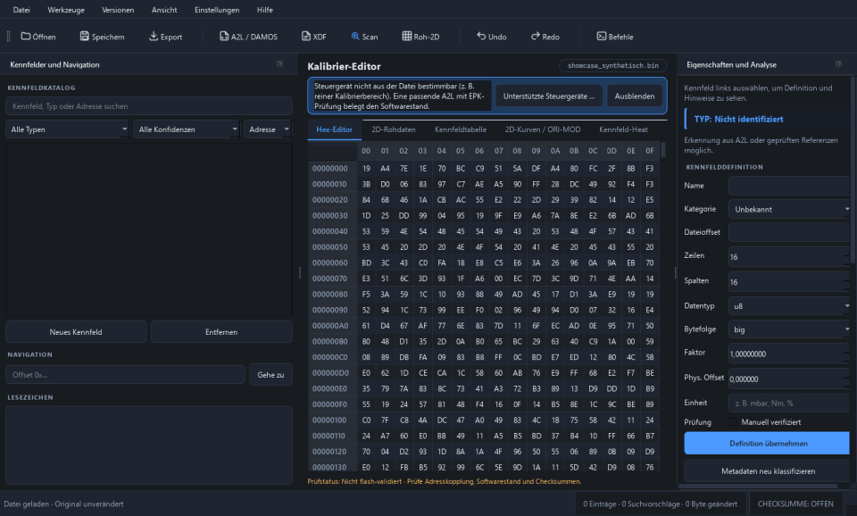
  <br><sub><b>Ein Klick – Kennfelder samt Achsen, jeweils mit Beweisart und gemessener Konfidenz.</b></sub>
</p>

<table>
<tr>
<td width="50%" align="center">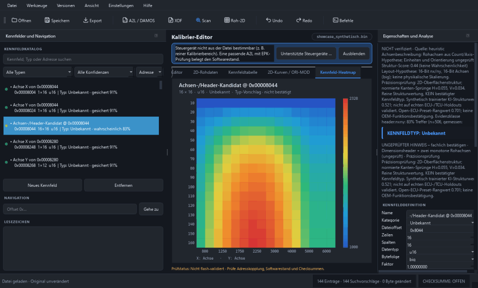<br><sub><b>3D-Ansicht</b> – Form eines Kennfelds sofort erfassen</sub></td>
<td width="50%" align="center">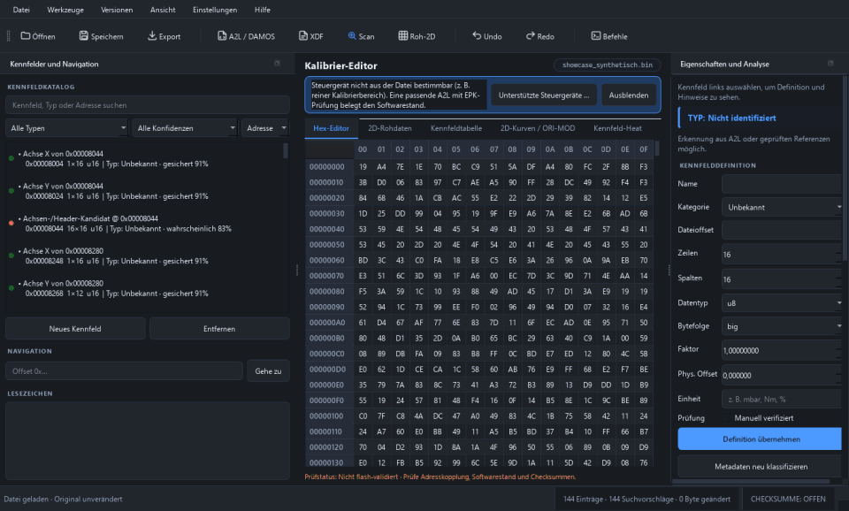<br><sub><b>ORI/MOD-Vergleich</b> – jede Zelle, jede Differenz</sub></td>
</tr>
<tr>
<td width="50%" align="center">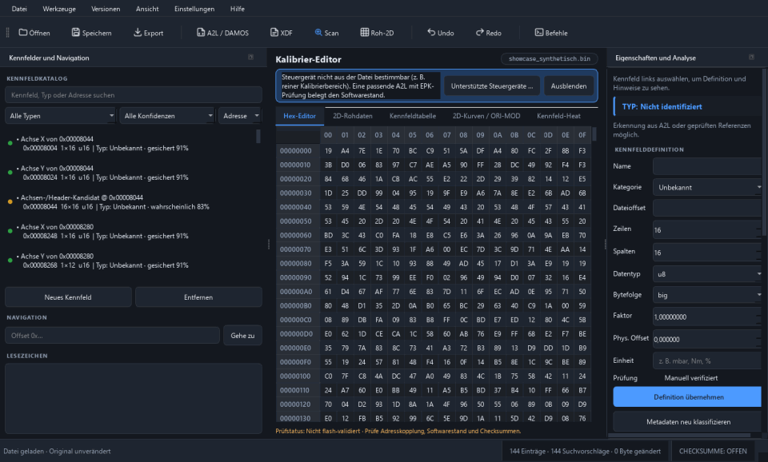<br><sub><b>Filter</b> – nach Konfidenz, Prüfstatus und Beweisart</sub></td>
<td width="50%" align="center">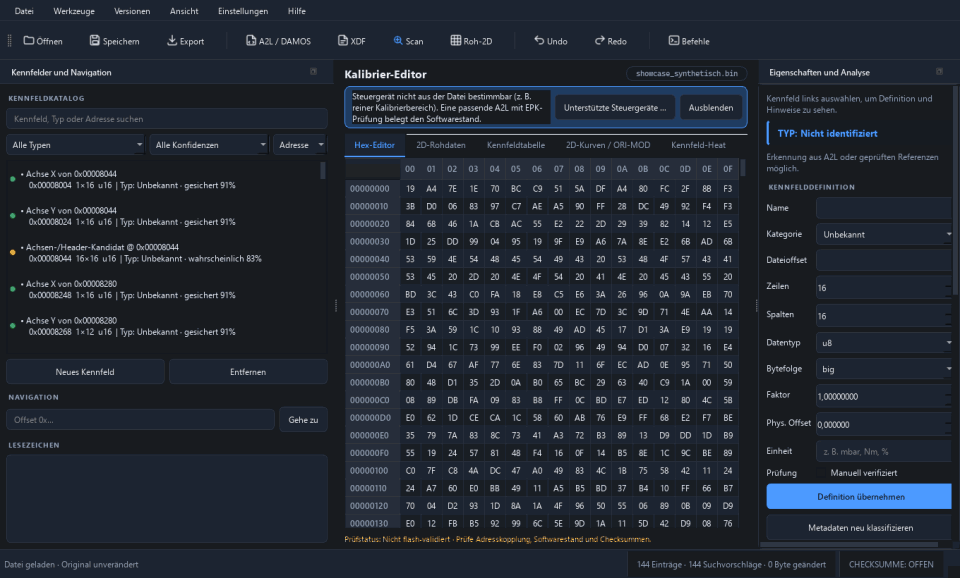<br><sub><b>Unterstützte Steuergeräte</b> – mit Messwerten direkt in der App</sub></td>
</tr>
</table>

<details>
<summary><b>📸 Weitere Ansichten</b></summary>
<br>

| Kennfeldtabelle (hell) | Heatmap (dunkel) | 3D-Ansicht (dunkel) |
|:---:|:---:|:---:|
| 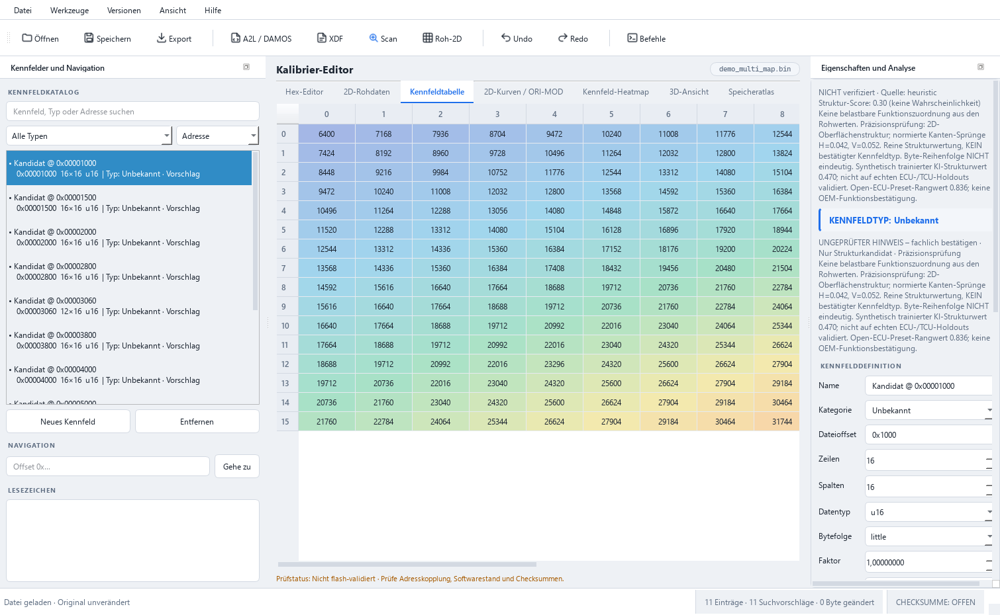 | 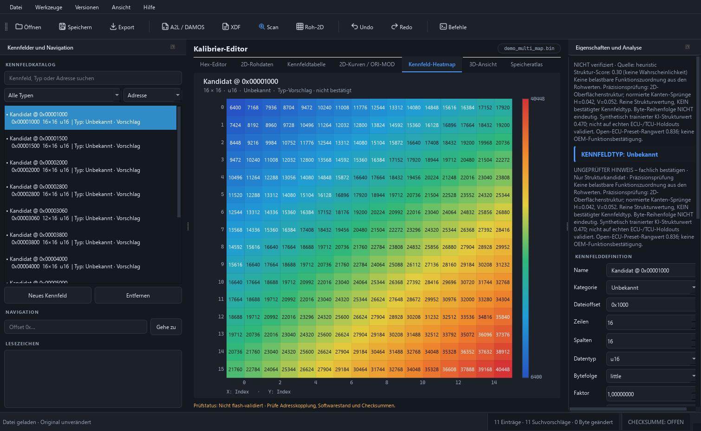 | 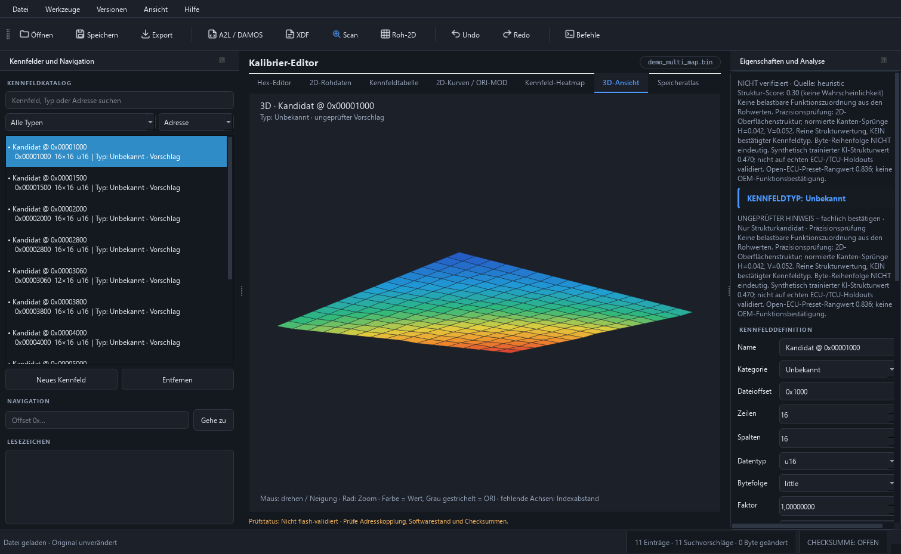 |
| **Softwarestand-Vergleich** | **Kennfeldpaket** | **English UI** |
| 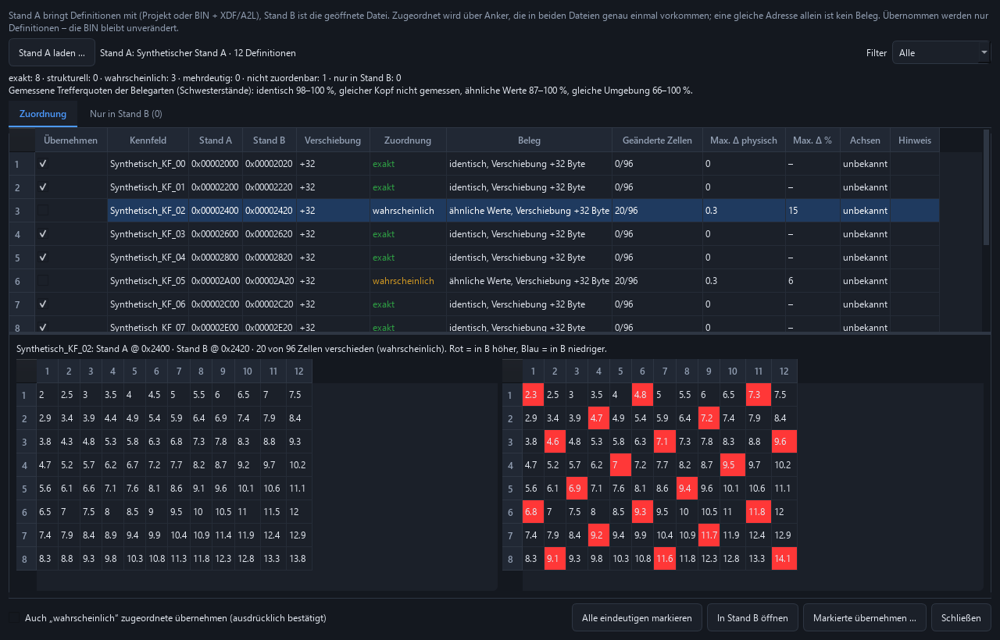 | 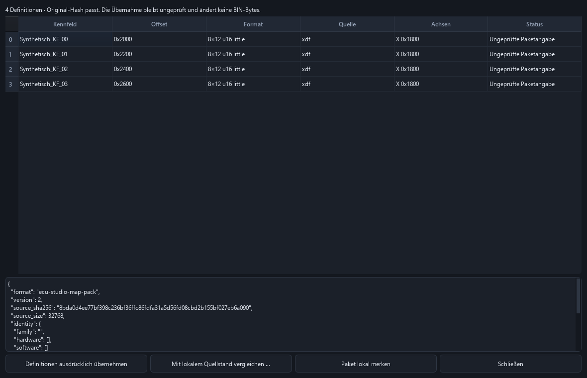 |  |

<sub>Alle Aufnahmen mit synthetischen Demo-Dateien aus <a href="examples/README.md"><code>examples/demo</code></a>.</sub>

</details>

---

<a id="funktionsweise"></a>

## 🔬 Beweis statt Bauchgefühl

Die meisten Werkzeuge suchen nach „glatten Flächen“. ECU Studio AI fragt zuerst: **Wo greift der Programmcode
auf Daten zu – und mit welchen Achsen?** Jeder Fund wird nach seiner stärksten Beweisart eingestuft.
Die Trefferquote jeder Beweisart wurde an Herstellerdefinitionen gemessen:

| Beweisart | Was gefunden wird | Trefferquote |
|---|---|---:|
| 🟢 **Code-Verweis + zwei Achsen** | Der Code lädt Kennfeld und beide Achsen gemeinsam | **100 %** <sub>(227)</sub> |
| 🟢 **Code-Verweis + eine Achse** | Kennlinie, vom Code mit ihrer Achse geladen | **99 %** <sub>(159)</sub> |
| 🟢 **Code-Verweis** | Startadresse direkt aus dem Programmcode | **97 %** <sub>(35)</sub> |
| 🟢 **Kopf-Datensatz mit Achsen** | `nx, ny, X-Achse, Y-Achse, Werte` direkt hintereinander | **82–98 %** <sub>(945)</sub> |
| 🟢 **Achse aus Kopf-Datensatz** | Stützstellen eines solchen Datensatzes | **91 %** <sub>(2461)</sub> |
| 🟡 **Achsen-Array** | Anzahl + steigende Stützstellen | **57 %** <sub>(2538)</sub> |
| 🔴 **nur Datenmuster** | glatte Fläche ohne weiteren Beleg – ein Lernmodell ordnet nach | **23 %** <sub>(1135)</sub> |

<sub>Anzahl der gemessenen Funde in Klammern. Gemessen auf MS43, MS42, MS45, MSS54, Hyundai ×2 und den Hersteller-A2L
von ME9, ME9.2.1 und EDC17CP09; die MSD80/85-Teststände bleiben außen vor. Klassen, Lernmodell und Grenzen:
<a href="docs/MODELLKARTE.md">docs/MODELLKARTE.md</a>.</sub>

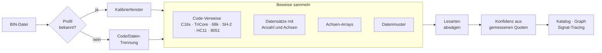

> [!NOTE]
> Alle Funde sind **Geometrie-Hypothesen**: Start, Größe, Datentyp und Achsen. Name, Einheit und Funktion kommen
> nur aus einer passenden Definition oder deiner eigenen Prüfung – nie aus einer Vermutung.

<details>
<summary><b>🧪 Neu in der Forschung: Kennfelder aus TriCore-Interpolationsaufrufen (Siemens MSD80)</b></summary>
<br>

Siemens-MSD80-Vollflashs sind Infineon-TriCore-Code. Die Interpolationsroutinen bekommen Tabellendaten und die Köpfe
beider Achsen direkt in Registern übergeben (`a4` / `a5` / `a6`), teils über Stackslots oder eine getrennte
Achsensuche. ECU Studio AI liest diese Aufrufe aus und leitet Zellbreite und Vorzeichen aus den Ladebefehlen der
Routine ab.

Auf einem MSD80-Vollflash mit Community-XDF (Entwicklungsdaten, Teilreferenz): **39 → 73 von 99** Kennfeldern exakt,
Datentyp bei 62 davon richtig, gemeinsame Achsen 37/37, keine neuen Widersprüche zur Referenz.
Ausführlich: [docs/ANALYSE_2026-10-30.md](docs/ANALYSE_2026-10-30.md).

</details>

---

<a id="erkennung"></a>

## 📊 Erkennungsgüte

Blind gemessen: Die Herstellerdefinition dient **nur als Referenz**, nie als Eingabe. Präzision steht nur dort,
wo die Referenz vollständig ist. **Test** = Daten, die nie zum Einstellen der Erkennung verwendet wurden.

| Steuergerät | Referenz | Exakt erkannte Kennfelder | Präzision |
|---|---|---|---:|
| Bosch EDC17CP09 | Hersteller-A2L | `█████████████████░░░░░░░░░` **463** / 703 | **85 %** |
| Siemens MSD85 · *Test* | Hersteller-A2L | `███████░░░░░░░░░░░░░░░░░░░` **279** / 1026 | **81 %** |
| Siemens MSD80 · *Test* (6 Stände) | Hersteller-A2L | `███████░░░░░░░░░░░░░░░░░░░` **217–224** / 864 | **81–82 %** |
| Bosch EDC16C35 | Hersteller-A2L | `███████████████████░░░░░░░` **283** / 387 | **81 %** |
| Bosch EDC16C31 | Hersteller-A2L | `███████████████████░░░░░░░` **272** / 364 | **82 %** |
| Siemens MS43 | Community-XDF | `██████████████░░░░░░░░░░░░` **197** / 379 | **79 %** |
| BMW ME9.2.1 | Hersteller-A2L | `██████████░░░░░░░░░░░░░░░░` **170** / 460 | **72 %** |
| Siemens MSD80 Vollflash · *Entwicklung* | Community-XDF (Teil) | `███████████████████░░░░░░░` **73** / 99 | – |
| Denso SH-2 (Subaru) | RomRaider (Auswahl) | **147–178** | – |

<sub>Balken = Anteil exakt gefundener Kennfelder. Die MSD80/85-Teststände sind reine Kalibrierbereiche ohne
Programmcode; die TriCore-Codeanalyse wirkt nur auf Vollflashs.</sub>

**Keine Fehlalarme auf Nicht-Kennfelddaten:** 9 Zufallsdateien bis 2 MB, komprimierte Daten, gelöschter Flash, Nullen
→ **0** Kandidaten. Auf reinem Programmcode (Windows-DLLs) entstehen Funde, alle eingestuft als *Vermutung*.

> 📈 **Wie sich die Erkennung von Version zu Version verbessert hat: [docs/PROGRESS.md](docs/PROGRESS.md)**<br>
> 🔁 Selbst nachmessen: `python -m ecu_studio.tools.benchmark_suite` · Workflow: [docs/REFERENCE_VALIDATION.md](docs/REFERENCE_VALIDATION.md)

---

<a id="steuergeraete"></a>

## 🚗 Steuergeräte

| Familie | Prozessor | Code-Verweise | Achsen | Status |
|---|---|:---:|:---:|---|
| Bosch EDC17CP09 (BMW) | TriCore | – | ✅ | ✅ gemessen · Hersteller-A2L |
| Siemens MSD80 (BMW) | TriCore | ✅ <sub>Vollflash</sub> | ✅ | ✅ unabhängig gemessen · Hersteller-A2L |
| Siemens MSD85 (BMW) | <sub>ungeprüft</sub> | – | ✅ | ✅ unabhängig gemessen · Hersteller-A2L |
| Bosch EDC16C31 / C35 (BMW) | PowerPC | – | ✅ | ✅ gemessen · Hersteller-A2L |
| BMW ME9 / ME9.2.1 | PowerPC | – | ✅ | ✅ validiert · Hersteller-A2L |
| Siemens MS43 (BMW) | C167 | ✅ | ✅ | ✅ validiert · Standard-XDFs inklusive |
| Siemens MS41 / MS42 (BMW) | C167 | ✅ | ✅ | 🟡 gemessen, Erkennung gering (MS42: 22 von 213 exakt) |
| Siemens MS45 | C167 | – | ✅ | 🟡 gemessen, Erkennung gering (30 von 472 exakt) |
| Bosch ME7 / ME7.5 (Volvo, VAG) | C167 | ✅ | ✅ | ✅ gemessen |
| BMW MSS54 | CPU32 | – | ✅ | ✅ gemessen · vollständige XDF |
| GM P01 | 68k | ✅ | – | ✅ gemessen |
| Denso SH-2 (Subaru) | SH-2 | ✅ | ✅ | ✅ gemessen |
| Bosch M4.4 · Motronic · Renault Fenix | 8051 · 68HC11 | 🟡 | – | ✅ gemessen |
| Bosch MED17.1.62 · MED9 | TriCore · PowerPC | – | ✅ | 🟡 nur Teil-Referenz |
| Continental SIM2K (Hyundai) | TriCore | – | 🟡 | 🟡 gemessen, Erkennung unzureichend |
| Speeduino (Open Source) | AVR / ARM | – | – | 🟡 gemessen (14 Abstimmungen), ohne Definition schwach – `.ini` ist öffentlich |
| Delco Multec S („D98…“) | HC12 | – | – | ⚪ keine rechtlich nutzbaren Referenzdaten – [Recherche](docs/DELCO_D98_RESEARCH.md) |
| EDC17 (weitere) · MED17.5/17.7 · MG1 · MD1 · Simos · SID | – | – | – | ⚪ nicht validiert – keine rechtlich sicheren Referenzdaten öffentlich |

<sub>✅ gemessen · 🟡 teilweise · ⚪ noch keine Referenzdaten. Code-Verweise = Kennfeldadressen aus dem Programmcode.
Alle Softwarestände und Zahlen: <a href="docs/ECU_SUPPORT.md">docs/ECU_SUPPORT.md</a> · in der App:
<b>Hilfe → Unterstützte Steuergeräte …</b></sub>

> 🤝 **Du hast ein Original mit passender, rechtmäßig nutzbarer Definition?** Genau solche Messungen bringen das
> Projekt weiter – siehe [CONTRIBUTING.md](CONTRIBUTING.md). Bitte **keine Original-Firmware hochladen**.

---

<a id="funktionen"></a>

## ✨ Alle Funktionen

<table>
<tr>
<td width="33%" valign="top">

### 🔍 Erkennen
- **Kennfelder ohne Definition** über Programmcode-Verweise, Datensätze mit Achsen und Datenmuster
- **Achsen** erkannt, zugeordnet und als **gemeinsame Achsgruppen** dargestellt
- **Gemessene Konfidenz** je Fund
- **Dubletten** und Überwachungskopien markiert
- **Softwarestand-Vergleich** mit Namensübertragung
- Funktionsgraph und Signal-Tracing

</td>
<td width="33%" valign="top">

### 🛡️ Prüfen
- **Flash-Preflight** für jede geänderte Byteposition
- **Zwillingskennfelder** auf gleiche Änderung geprüft
- **Checksummen** mit geprüften Profilen, Korrektur mit Byte-Vorschau, Suche unbekannter Layouts
- **Software-Kennung (EPK)** gegen die Definition
- Drei getrennte Stufen: Prüfsummen · Preflight · Flashvalidierung

</td>
<td width="33%" valign="top">

### ✏️ Bearbeiten
- **Definitionen:** XDF, A2L/DAMOS, RomRaider, CSV, HEX/S19, [Kennfeldpakete](docs/MAP_PACK.md)
- **Ansichten:** Tabelle, Heatmap, 2D, **3D**, Hex-Editor, Speicheratlas
- **ORI/MOD-Vergleich** zellgenau
- **Definition bearbeiten** mit Vorschau, **XDF-Export** mit Rückimport-Prüfung
- Undo/Redo, Projektstände, Batch mit Vorschau

</td>
</tr>
</table>

---

<a id="installation"></a>

## 🚀 Installation

> **Drei Schritte – ohne Python, ohne Terminal.**

| | |
|:---:|---|
| **1** | **[Neueste Version herunterladen](https://github.com/PCTestAdmin/ECU-Studio-AI/releases/latest)** – `…-windows-x64.zip` (portabel: entpacken, fertig) oder `…-setup.exe` (Installer, ohne Administratorrechte) |
| **2** | `ECU-Studio-AI.exe` starten |
| **3** | **Datei → BIN öffnen …** – zum Ausprobieren liegt unter [`examples/demo`](examples/README.md) eine synthetische Demo-Datei |

<details>
<summary><b>⚠️ Windows meldet „Der Computer wurde durch Windows geschützt“?</b></summary>
<br>

ECU Studio AI ist noch **nicht code-signiert**, deshalb warnt Windows SmartScreen beim ersten Start.

- Im Fenster **„Weitere Informationen“** → **„Trotzdem ausführen“**, oder
- **vor dem Entpacken**: Rechtsklick auf die ZIP → **Eigenschaften** → **„Zulassen“** anhaken → OK.

Echtheit prüfen: Die SHA-256 der Datei (`Get-FileHash <datei>`) muss mit der `.sha256`-Datei des Releases
übereinstimmen; die Build-Herkunft belegt `gh attestation verify <datei> --repo PCTestAdmin/ECU-Studio-AI`.
</details>

<details>
<summary><b>🔄 Wie funktionieren die automatischen Updates?</b></summary>
<br>

| Schritt | Was passiert |
|---|---|
| Prüfen | Nur wenn du es willst: **Einstellungen → Jetzt nach Updates suchen**, oder automatisch beim Start und höchstens einmal täglich, sobald du **Automatisch nach Updates suchen** einschaltest (ab Werk aus). Abgefragt wird nur die GitHub-Releases-API, nur **stabile** Versionen; es wird nichts hochgeladen. Ohne Internet passiert still nichts. |
| Fragen | Fenster mit Version und Änderungen: **Jetzt aktualisieren** · **Später erinnern** · **Diese Version überspringen**. |
| Laden | Nur von den Releases dieses Repositorys; SHA-256 gegen die veröffentlichte Prüfsumme **und** GitHubs eigene Angabe. |
| Installieren | Erst nach dem Schließen (ungespeicherte Arbeit wird abgefragt) durch einen separaten Updater: jede Datei geprüft, eigene Dateien übernommen, alte Version gesichert. |
| Absichern | Selbsttest der neuen Version – bei einem Fehler automatisch zurück zur alten. **Einstellungen → Vorherige Version wiederherstellen …** holt sie jederzeit zurück. |

Projekte (`%USERPROFILE%\.ecu_studio_ai`) und Einstellungen liegen außerhalb des Programmordners und bleiben
unberührt. Protokoll: `%LOCALAPPDATA%\ECUStudioAI\updates\update.log`. Vor jeder Veröffentlichung wird genau dieser
Weg automatisch auf Windows Server 2022 und 2025 durchgespielt.
</details>

---

<a id="sicherheit"></a>

## 🛡️ Sicherheit und Grenzen

> [!WARNING]
> **ECU Studio AI gibt keine Flashfreigabe.** Checksummen werden nur mit einem geprüften, an die Original-Firmware
> gebundenen Profil verifiziert – Signaturen und weitere Prüfungen des Steuergeräts bleiben ungeprüft. Geänderte
> Dateien vor dem Flashen mit einem geeigneten Werkzeug prüfen. Eingriffe können Typgenehmigung, Abgasverhalten und
> Versicherungsschutz betreffen.

| ✅ Was ECU Studio AI tut | 🚫 Was es bewusst **nicht** tut |
|---|---|
| Original unverändert lassen – Änderungen als nachvollziehbare Ebene | Automatisches „Stage 1“-Tuning |
| Funde mit Beweis und gemessener Konfidenz zeigen | Abgas- oder Schutzfunktionen abschalten |
| Checksummen nur mit geprüftem Profil korrigieren | Flashfreigaben erteilen |
| Firmware lokal halten – sie wird nie hochgeladen | Kennfeldnamen erfinden |

- **Keine Firmware im Repository** – Tests verhindern Programmdateien, Archive und Firmware außerhalb von `examples/`.
- **Fremddaten:** mitgelieferte MS4x-XDFs (MS4x Dev Team) und rusEFI-Presets unter GPL-3.0, Herkunft in den `NOTICE.txt`
  unter `src/ecu_studio/recognition/data/`.
- Sicherheitslücken bitte vertraulich melden: [SECURITY.md](SECURITY.md).

---

<a id="entwicklung"></a>

## 🧑‍💻 Entwicklung

```bat
start_windows.bat                         :: Umgebung anlegen und Oberfläche starten (Python 3.10–3.13)
python -m pytest -q                       :: alle Tests
build_exe_windows.bat                     :: Windows-Paket bauen (ZIP + Installer, mit Tests)
```

| | |
|---|---|
| 📚 [Dokumentation](docs/README.md) | Aufbau des Quellcodes, Werkzeuge, Benchmarks, Forschungsberichte |
| 🚢 [Release-Ablauf](docs/RELEASE.md) | Version, CHANGELOG, Tag – Build, Update-Test und Veröffentlichung laufen automatisch |
| 🧪 [Beispiele](examples/README.md) | Synthetische Demo-Dateien und Vorlagen |
| 📝 [CHANGELOG](CHANGELOG.md) | Alle Änderungen |
| 🤝 [Mitmachen](CONTRIBUTING.md) | Besonders willkommen: **Messungen an weiteren Steuergeräten** |

### 🗺️ Roadmap

<a href="ROADMAP.md"><picture>
  <source media="(prefers-color-scheme: dark)" srcset="docs/images/roadmap-dark.svg">
  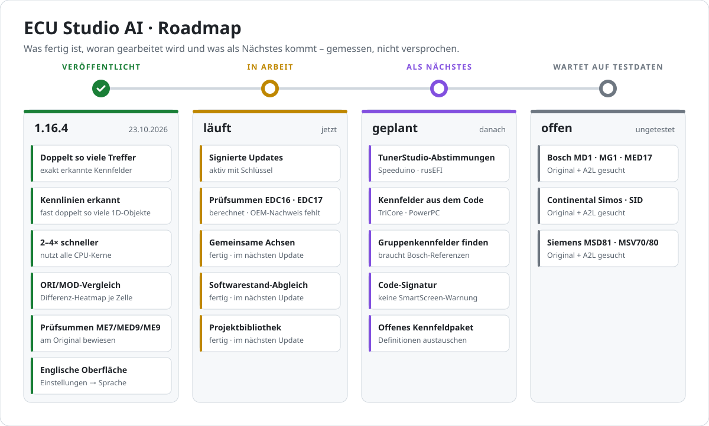
</picture></a>

**→ [Ganze Roadmap](ROADMAP.md)** – jede neue Funktion mit kurzem Clip aus der App

<div align="center">
<br>
<sub>ECU Studio AI · <a href="LICENSE">GPL-3.0</a> · Kalibrierwerkzeug ohne Herstellerbezug – kein Ersatz für eine fachliche Prüfung</sub>
</div>
