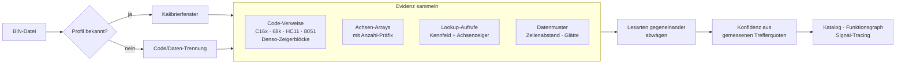

<div align="center">

# ECU Studio AI

**Kalibrier-Workbench für Motor- und Getriebesteuergeräte –
Kennfelder finden, verstehen und nachvollziehbar bearbeiten, auch ohne Definition.**

[](https://github.com/PCTestAdmin/ecu-studio-ai/actions/workflows/tests.yml)
[](LICENSE)
[](pyproject.toml)
[](#installation)
[-41CD52.svg?logo=qt&logoColor=white)](https://doc.qt.io/qtforpython-6/)


</div>

## Inhalt

- [Was es kann](#was-es-kann)
- [So funktioniert die Erkennung](#so-funktioniert-die-erkennung)
- [Gemessene Erkennungsgüte](#gemessene-erkennungsgüte)
- [Unterstützte Steuergeräte](#unterstützte-steuergeräte)
- [Installation](#installation)
- [Entwicklung](#entwicklung)
- [Roadmap](#roadmap)
- [Mitmachen](#mitmachen)
- [Wichtige Hinweise](#wichtige-hinweise)

## Was es kann

| | |
|---|---|
| 🔍 **Kennfeldsuche ohne Definition** | Findet Kennfelder, Kennlinien und Achsen direkt in den Rohdaten – über Datenmuster, Achsen-Arrays und Verweise im Programmcode. |
| 📊 **Kalibrierte Konfidenz** | Jede Fundstelle zeigt die *gemessene* Trefferquote ihrer Beweisart: **gesichert**, **wahrscheinlich** oder **Vermutung**. |
| 🛡️ **Flash-Preflight** | Prüft vor dem Export: unveränderte Zwillings- und Überwachungskopien, Änderungen im Programmcode, zerstörte Achsen, ungewöhnliche Sprünge, Checksummenstatus. |
| 🕸️ **Funktionsgraph** | Zeigt, welche Kennfelder dieselbe Code-Routine liest oder dieselben Achsen nutzt. |
| 📡 **Signal-Tracing** | Ermittelt die RAM-Eingänge jedes Kennfeldzugriffs – direkt als Logger-Liste nutzbar. |
| 📐 **Achsen-Semantik** | Schlägt Größe und Skalierung von Stützstellen vor (Drehzahl, Temperatur, Last …). |
| 🔗 **Definitionen koppeln** | TunerPro XDF (XML und Textformat 1.x), A2L/DAMOS, RomRaider-XML, CSV; Standard-XDFs für Siemens MS41/42/43 inklusive. |
| 🎨 **Ansichten** | Hex-Editor, 2D-Rohdaten, farbcodierte Tabelle, Heatmap, 3D-Fläche, ORI/MOD-Kurven, Speicheratlas – hell und dunkel. |
| ↩️ **Sicher bearbeiten** | Original bleibt unverändert, Undo/Redo, Projektstände, Batch mit Vorschau, Änderungsprotokoll. |

| Kennfeldtabelle (hell) | 3D-Ansicht (dunkel) |
|---|---|
|  |  |

<sub>Screenshots mit der synthetischen Demo-Datei `examples/demo_multi_map.bin`.</sub>

## So funktioniert die Erkennung



Wo der Programmcode auf ein Kennfeld zeigt, stimmt der Start praktisch immer. Wo nur Datenmuster sprechen,
ist es eine Vermutung – und wird auch so angezeigt. Alle Funde sind **Geometrie-Hypothesen**: Name,
Einheit und Funktion kommen nur aus einer passenden Definition oder deiner Prüfung.

## Gemessene Erkennungsgüte

Blind gemessen gegen öffentliche Definitionen – die Definition dient nur als Referenz, nie als Eingabe
(`python -m ecu_studio.tools.structure_benchmark BIN XDF`). 2D-Kennfelder ab 4×4:

| Datei | gefunden | exakt (Start, Größe, Breite) | Präzision |
|---|---|---|---|
| Siemens MS43 430069 | **66 %** (vorher 4,5 %) | **197** von 379 (vorher 1) | **80 %** |
| Siemens MS42 0110C6 | **50 %** (vorher 13 %) | 22 von 213 (vorher 5) | **72 %** |
| Bosch ME7 (Volvo, 3 Stände) | **54–71 %** (vorher 5–10 %) | je 6 (vorher 0) | nicht belastbar¹ |
| Bosch ME7.5 (VAG 06A906032HS) | 46 % (vorher 36 %) | 50 (vorher 16), Kennlinien 132 | nicht belastbar¹ |
| Bosch ME7.5 (VAG 8E0909518AK) | 57 % (vorher 43 %) | 37 (vorher 16), Kennlinien 41 | nicht belastbar¹ |
| Denso SH-2 (Subaru 5EAT, 9 ROMs) | **93–100 %** (vorher 35–53 %) | **147–178** (vorher 15–27) | nicht belastbar¹ |
| GM P01 (68k) | 35 % (vorher 21 %) | 10 (vorher 1), Kennlinien 21 | nicht belastbar¹ |
| Volvo M4.4 (8051) · Opel E78 (PowerPC) | 54 % · 26 % | 8 · 1 | nicht belastbar¹ |

**Trefferquote je Beweisart** (MS43, MS42, Hyundai, MSS54; Anteil der Funde, die exakt an einem echten Objekt beginnen):

| Beweisart | Anzahl | Trefferquote |
|---|---:|---:|
| Code-Verweis + zwei Achsen | 227 | 100 % |
| Code-Verweis ohne Achsen | 35 | 97 % |
| Achsen-Arrays mit Anzahl-Präfix | 1020 | 97 % |
| Code-Verweis + Achse (Kennlinie) | 159 | 99 % |
| nur Datenmuster | 732 | 19 % → **Lernmodell**, s. u. |

**Lernmodell für Datenmuster-Funde** – geprüft auf einer beim Training ausgelassenen Familie (Präzision bei 80 % Trefferquote):

| Familie | ohne Modell | mit Modell |
|---|---:|---:|
| Hyundai SIM2K (TriCore) | 14 % | **34 %** |
| BMW MSS54 (68k) | 7 % | **32 %** |
| alte 8-Bit-Motronic/Fenix | 5 % | **35 %** |
| Siemens MS42/MS43 | 29 % | **50 %** |

<sub>¹ Diese Definitionen enthalten nur einen Teil der Kennfelder (Subaru: 147–183 von 250–317 Beschreibungsblöcken). Details und Verlauf: [CHANGELOG](CHANGELOG.md).</sub>

## Unterstützte Steuergeräte

| Familie | Prozessor | Code-Verweise | Achsen | Status |
|---|---|:---:|:---:|---|
| Siemens MS41 / MS42 / MS43 (BMW) | C167 | ✅ | ✅ | gemessen, Standard-XDFs inklusive |
| Bosch ME7 / ME7.5 (Volvo, VAG) | C167 | ✅ Lookup-Aufrufe, Basis auto | ✅ Kopf | gemessen |
| Denso (Subaru) | SH-2 | ✅ Beschreibungsblöcke | ✅ | gemessen |
| GM P01 / E-Steuergeräte | 68k | ✅ Absolutoperanden | – | gemessen |
| Bosch M4.4 (Volvo) | 8051 | ◐ bestätigend | – | gemessen |
| Bosch/Continental E78 (Opel) | PowerPC | ❌ | – | gemessen; Code-Verweise offen |
| Bosch Motronic (Porsche 911/944/928/964) | 8051 | – | – | gemessen; XDF 1.x lesbar |
| Renault Fenix 1B/3, Peugeot 205 Turbo | 68HC11 | ◐ bestätigend | – | gemessen |
| Continental SIM2K (Hyundai) | TriCore | ❌ | ◐ | gemessen, Lernmodell; Code-Verweise offen |
| BMW MSS54 | 68k (CPU32) | ❌ | ✅ Header | gemessen, Lernmodell; Code-Verweise offen |

## Installation

Voraussetzung: Windows und Python 3.10–3.12 mit dem Launcher `py`.

```bat
start_windows.bat
```

Legt beim ersten Start `.venv` an, installiert die Abhängigkeiten und startet die Oberfläche. Manuell:

```bat
py -m venv .venv
.venv\Scripts\activate
pip install -e .[dev]
python -m ecu_studio.main
```

Eigenständige EXE: `build_exe_windows.bat` (PyInstaller). Fertige Pakete erscheinen unter
[Releases](https://github.com/PCTestAdmin/ecu-studio-ai/releases).

## Entwicklung

```bat
python -m pytest -q                                              :: Tests
python -m ecu_studio.tools.structure_benchmark <bin> <xdf|csv>   :: Erkennung messen
python -m ecu_studio.tools.calibrate_confidence --pair <bin> <xdf>   :: Trefferquoten neu messen
python -m ecu_studio.tools.screenshot <bin> <ordner>              :: Oberfläche rendern
```

| Ordner | Inhalt |
|---|---|
| `src/ecu_studio/core` | Datenmodell, Formate, Erkennung (`structure_scan`, `axis_arrays`, `cpu_refs`, `preflight`, `function_graph`, `signal_trace`) |
| `src/ecu_studio/recognition` | Definitionskatalog, mitgelieferte XDFs, Modelle und Kalibrierdaten |
| `src/ecu_studio/ui` | PySide6-Oberfläche, Theme, Icons |
| `src/ecu_studio/tools` | Kommandozeilenwerkzeuge (Benchmarks, Kalibrierung, Training, Screenshots) |
| `tests` | pytest-Suite (läuft bei jedem Push unter Python 3.11 und 3.12) |
| `examples` | synthetische Demo-Dateien – keine echte Firmware |
| `docs/history` | Berichte früherer Versionen |

## Roadmap

- [x] Rasterfreie Kennfeldsuche, Achsen-Arrays, Code-Verweise (C16x)
- [x] Kalibrierte Konfidenz, Flash-Preflight, Funktionsgraph, Signal-Tracing
- [x] XDF-Textformat 1.x und tolerantes XML
- [x] Lernmodell für Datenmuster-Funde, familienübergreifend geprüft
- [x] Code-Verweise 68k (GM P01), ME7.5-Speicherbasis, Denso-Beschreibungsblöcke
- [x] Schnellere Suche bei großen Dateien (2- bis 5-mal)
- [ ] Code-Verweise für TriCore, PowerPC und CPU32 (MSS54)
- [ ] Logger-Anbindung für Signal-Tracing

## Mitmachen

Beiträge sind willkommen – besonders **Messungen an weiteren Steuergeräten**. Bitte lies vorher
[CONTRIBUTING.md](CONTRIBUTING.md). Wichtig: **Keine Original-Firmware in Issues oder Pull Requests hochladen.**

## Wichtige Hinweise

> [!WARNING]
> **Keine Checksummen-Korrektur, nicht flash-validiert.** Geänderte Dateien vor dem Flashen mit einem
> geeigneten Werkzeug prüfen. Eingriffe in Steuergeräte können Typgenehmigung, Abgasverhalten und
> Versicherungsschutz betreffen.

- **Keine Steuergeräte-Firmware im Repository.** `.gitignore` schließt `*.bin` außerhalb von `examples/` aus.
- **Lizenz:** GPL-3.0, siehe [LICENSE](LICENSE).
- **Fremddaten:** Die mitgelieferten MS4x-XDFs (MS4x Dev Team) und Open-ECU-Presets (rusEFI) stehen unter
  GPL-3.0; Herkunft und Prüfsummen in `src/ecu_studio/recognition/data/definitions/NOTICE.txt` und
  `src/ecu_studio/recognition/data/training/NOTICE.txt`.
