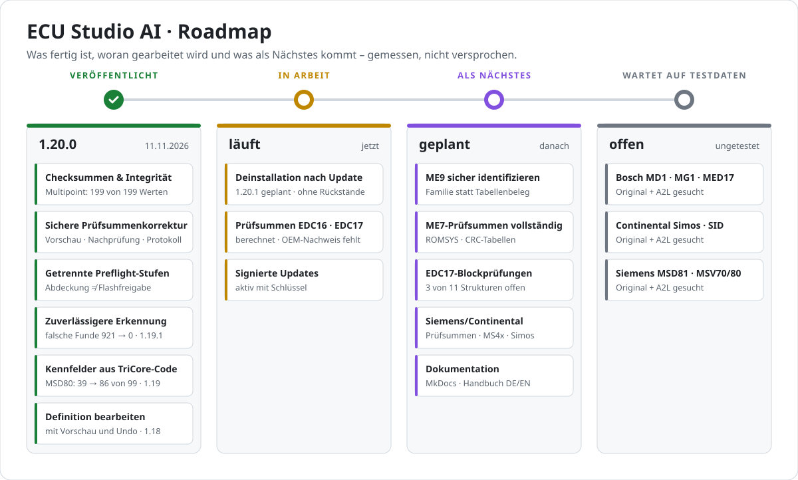
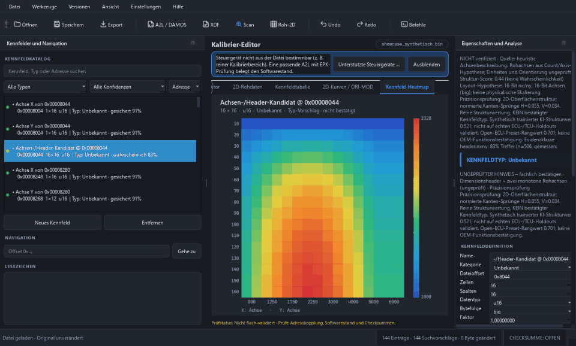
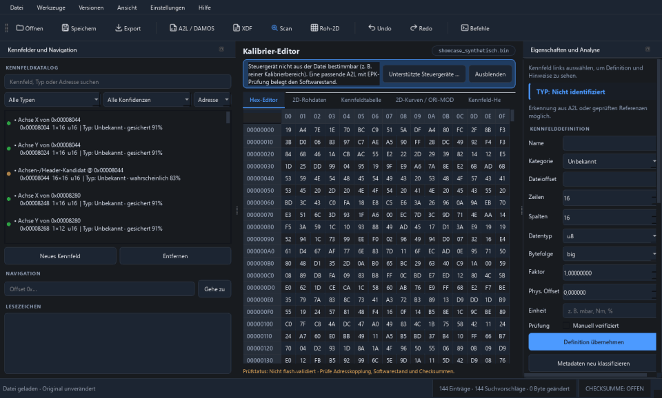
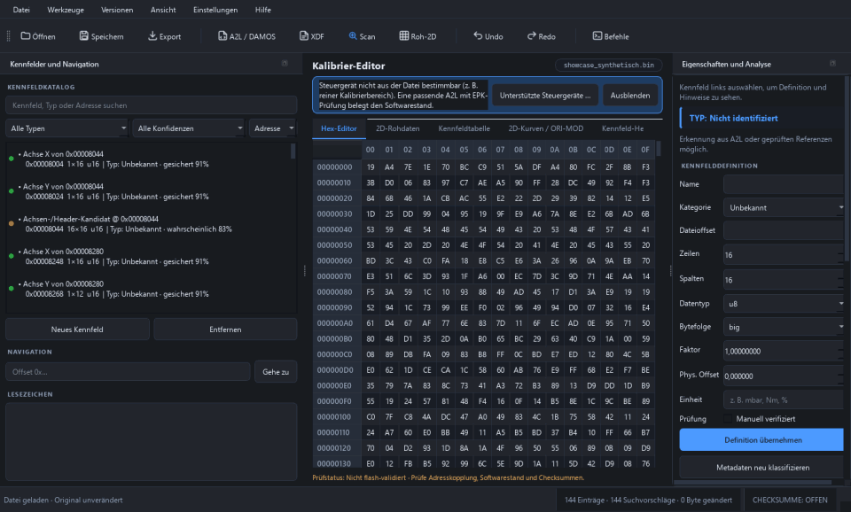
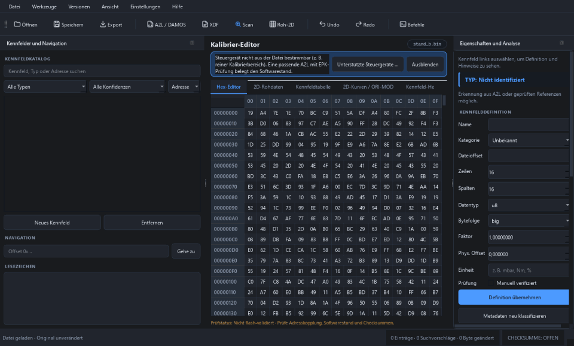
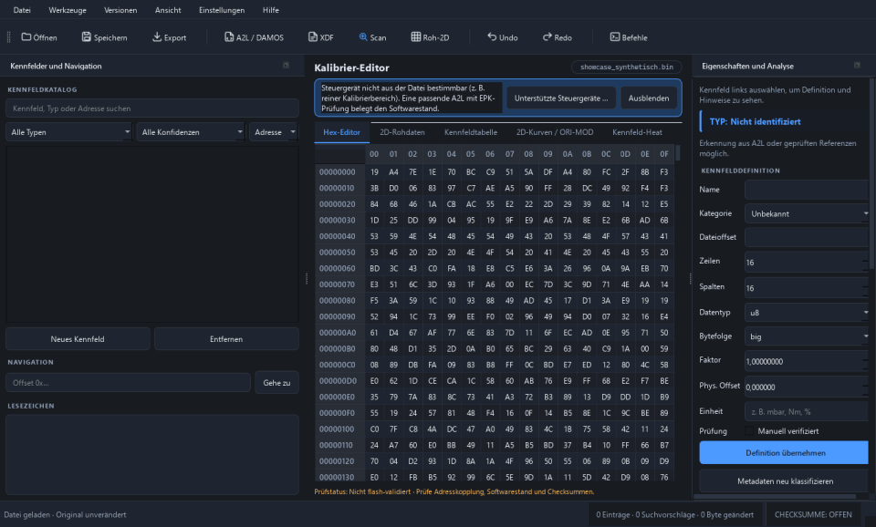
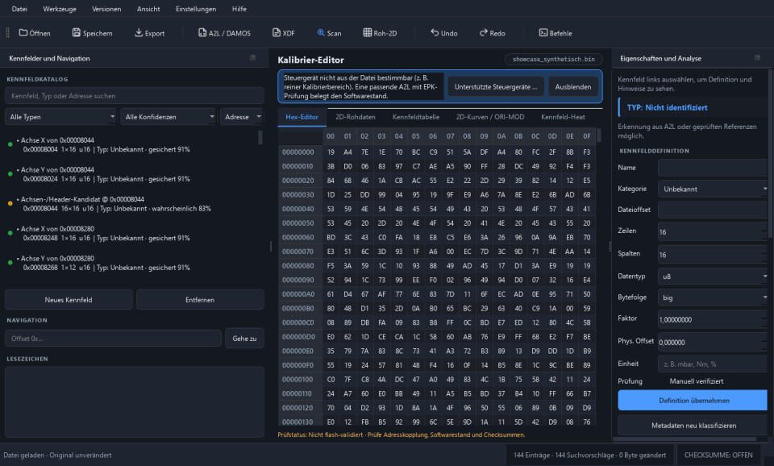
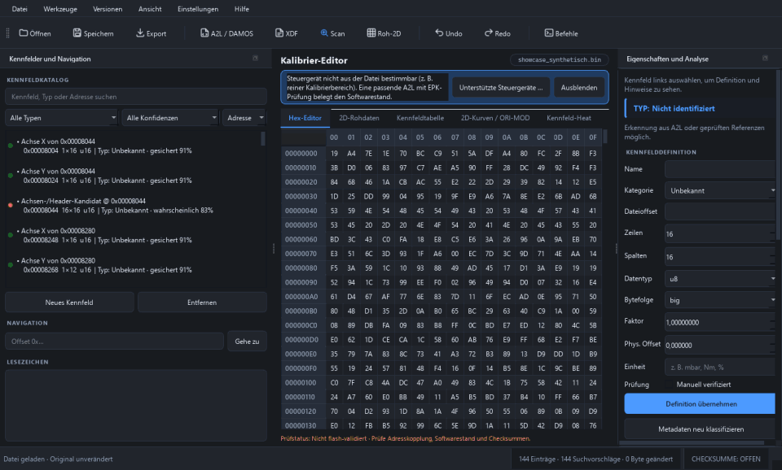
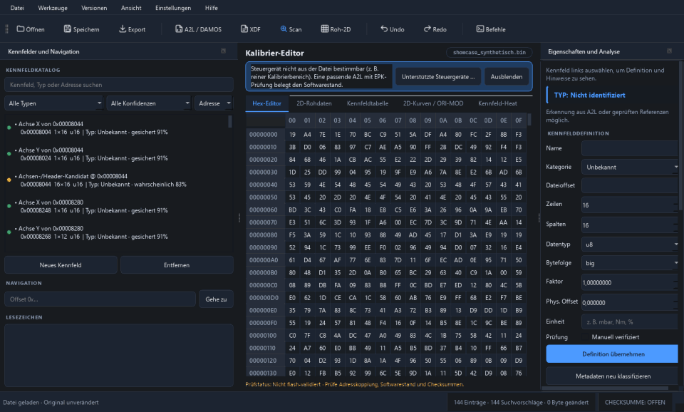
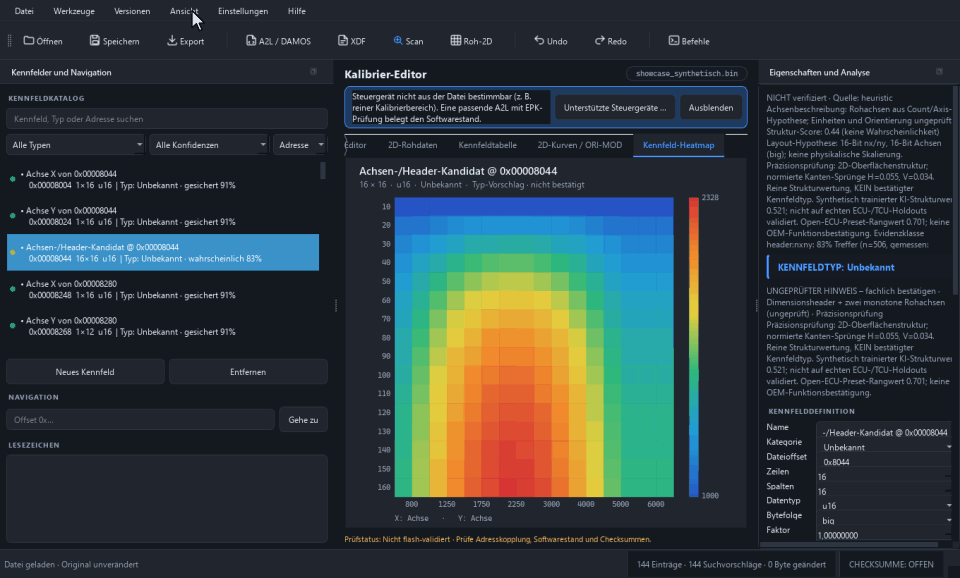

<picture>
  <source media="(prefers-color-scheme: dark)" srcset="docs/images/roadmap-dark.svg">
  
</picture>

  

&nbsp;

&nbsp;

 

## 

[Jetzt herunterladen](https://github.com/PCTestAdmin/ECU-Studio-AI/releases/latest). Die automatische Update-Suche
ist seit 1.18.0 ab Werk aus („Offline zuerst“) und lässt sich in den Einstellungen einschalten.

**1.20.0** bringt die **erste validierte Ausbaustufe** des Checksummen- und Integritätssystems
([Release Notes](docs/RELEASE_NOTES_1.20.0.md)). Keine untersuchte Originaldatei erreicht bisher eine vollständige
Checksummenabdeckung; eine erfolgreiche Teilprüfung ist keine vollständige Integritätsbestätigung, und es gibt keine
Flashfreigabe. Die Clips sind echte Aufnahmen der App mit einer synthetischen Vorführdatei (keine Herstellerdaten).
Die neuesten Funktionen stehen oben.

<table>
<tr><th align="left">Neu</th><th>Version</th></tr>
<tr><td>

**Checksummen & Integrität** – Ein gemeinsamer Bereich mit fünf klaren Status: gültig, ungültig, unvollständig, nicht unterstützt, unbekannt. Ein zufällig passendes Verfahren macht eine Datei nie gültig. Bosch-Multipoint (ME7.x, ME9, MED9) ist unabhängig belegt: 199 von 199 Herstellerwerten. Die Prüfung läuft im Hintergrund mit Fortschritt und Abbrechen ([Details](docs/CHECKSUMMEN.md)).

</td><td align="center"><b>1.20.0</b></td></tr>
<tr><td>

**Sichere Prüfsummenkorrektur** – Vorschau mit jedem Byte, ausdrückliche Bestätigung, unabhängige Nachprüfung vor dem Schreiben. Korrigierte Kopie und Änderungsprotokoll bleiben auch bei Schreibfehlern konsistent. Korrektur nur, wenn Steuergerät oder Datei das Verfahren ausreichend belegen.

</td><td align="center"><b>1.20.0</b></td></tr>
<tr><td>

**Ehrlicher Preflight** – Profil-Prüffelder, bekannte Prüfsummen, vollständige Abdeckung, Signaturen und Flashfreigabe werden getrennt angezeigt. Ein Teilprofil oder eine unvollständige Prüfung ergibt nie einen sauberen Preflight.

</td><td align="center"><b>1.20.0</b></td></tr>
<tr><td>

**Stabiler Definitionseditor** – Nach dem Öffnen einer anderen Firmware zeigt der Editor keine Werte der vorherigen Datei mehr; ohne Kennfeldauswahl sind die Bearbeitungsfunktionen gesperrt.

</td><td align="center"><b>1.20.0</b></td></tr>
<tr><td>

**Zuverlässigere Erkennung** – Prozessorarchitektur nur mit zwei unabhängigen Merkmalen. Keine Code-Belege auf fremden Architekturen, weniger Fehlfunde auf Text und Zeigertabellen. Auf sieben offenen Firmwareständen: nachweislich falsche Funde 921 → 0.

</td><td align="center"><b>1.19.1</b></td></tr>
<tr><td>

**Kennfelder aus TriCore-Programmcode** – Bei Siemens-MSD80-Vollflashs liest die Suche die Interpolationsaufrufe: Datenstart, beide Achsen und Zelltyp kommen direkt aus dem Code. MSD80 mit Community-XDF: 39 → 86 von 99 Kennfeldern exakt (Entwicklungsdaten).

</td><td align="center"><b>1.19</b></td></tr>
<tr><td>

**Drei Erkennungsebenen** – Definitionen, dann Code- und Strukturfunde, erst danach Datenmuster. Die App zeigt die Art des Belegs statt Prozentwerten. Eine falsche Definition (anderer Softwarestand) wird erkannt.

</td><td align="center"><b>1.19.0</b></td></tr>
<tr><td>

**Kennfelddefinition bearbeiten / prüfen** – <i>Strg+E</i>: Name, Adresse, Größe, Datentyp, Faktor, Einheit und Achsen ändern. <i>Prüfen</i> zeigt jede Änderung und eine Vorschau aus den echten Dateibytes, <i>Übernehmen</i> erst danach – rückgängig machbar, die BIN bleibt unverändert. 

</td><td align="center"><b>1.18</b></td></tr>
<tr><td>

**XDF-Export** – Den Katalog als TunerPro-XDF speichern. Jede exportierte Datei wird sofort mit dem eigenen Importer zurückgelesen und Feld für Feld verglichen – erst dann heißt es „Rückimport geprüft“. 

</td><td align="center"><b>1.18</b></td></tr>
<tr><td>

**Offline zuerst und lokale Referenzsuche** – Ohne eigene Einstellung baut die App keine Netzwerkverbindung auf. Beim Öffnen einer BIN werden passende Projekte und Kennfeldpakete auch über Hardware- und Softwarenummer gefunden, mit Stufe und Grund.

</td><td align="center"><b>1.18.0</b></td></tr>
<tr><td>

**Kennfeldpakete** – Definitionen als offenes Paket exportieren und in einem anderen Projekt importieren: Vorschau aller Einträge, Prüfung von Original-Hash und Konflikten, ausdrückliche Übernahme mit Undo. Keine BIN-Bytes im Paket. 

</td><td align="center"><b>1.17.0</b></td></tr>
<tr><td>

**Softwarestände vergleichen** – Stand A mit Definitionen laden: Die Kennfelder werden im geöffneten Stand B gefunden, auch wenn alles verschoben ist (hier +512 Byte). Unterschiede je Zelle nebeneinander, Definitionen gezielt übernehmen. 

</td><td align="center"><b>1.16.4</b></td></tr>
<tr><td>

**Doppelt so viele Treffer** – Ein Klick auf <i>Scan</i>: Die Suche findet Kennfelder über ihre Achsen im Kopf, jede Fundstelle bekommt eine gemessene Konfidenz. Anklicken zeigt sofort die Heatmap. 

</td><td align="center"><b>1.16.0</b></td></tr>
<tr><td>

**Konfidenz-Filter** – Nur gesicherte, nur wahrscheinliche oder nur geprüfte Kennfelder anzeigen – die Prozentwerte sind auf echten Referenzdaten gemessen. 

</td><td align="center"><b>1.16.0</b></td></tr>
<tr><td>

**ORI/MOD-Vergleich** – Zweite Datei wählen: Liste aller betroffenen Kennfelder und eine Differenz-Heatmap je Zelle (rot = höher, blau = niedriger). 

</td><td align="center"><b>1.16.0</b></td></tr>
<tr><td>

**Unterstützte Steuergeräte** – Für jede Familie ehrlich angezeigt: validiert, teilweise, experimentell oder nicht validiert – mit Messwerten. 

</td><td align="center"><b>1.16.0</b></td></tr>
<tr><td>

**Englische Oberfläche** – <i>Einstellungen → Sprache / Language</i>. Standard ist die Systemsprache, Projekte bleiben sprachunabhängig. 

</td><td align="center"><b>1.16.0</b></td></tr>
<tr><td>

**2–4× schneller** – Alle CPU-Kerne arbeiten mit – große Dateien in ~10 statt ~33 Sekunden.

</td><td align="center"><b>1.16.0</b></td></tr>
<tr><td>

**Kennlinien** – Fast doppelt so viele Kennlinien und Achsen werden erkannt.

</td><td align="center"><b>1.16.0</b></td></tr>
<tr><td>

**Steuergerät erkannt** – Nach dem Öffnen: Familie, Softwarestand und ob sie getestet ist.

</td><td align="center"><b>1.16.0</b></td></tr>
<tr><td>

**Namen übernehmen** – Kennfeldnamen aus einem verwandten Softwarestand mit Definition übertragen.

</td><td align="center"><b>1.16.0</b></td></tr>
<tr><td>

**Prüfsummen ME7 · MED9 · ME9** – Prüfen und korrigieren – nur wenn das Verfahren am Original bewiesen ist.

</td><td align="center"><b>1.16.0</b></td></tr>
</table>

 

## 

**Deinstallation nach einem In-App-Update ohne Rückstände – umgesetzt und getestet, noch nicht veröffentlicht.**
Wurde eine Installation über „Jetzt nach Updates suchen“ aktualisiert, blieben nach der Deinstallation
Programmdateien zurück, die erst mit der neuen Version hinzukamen (1.19.1 → 1.20.0: eine Datei; Benutzerdaten nicht
betroffen). Der Fix kommt ohne pauschale Löschregel aus:
- Der Deinstaller entfernt genau die Dateien, die laut `RUNTIME_INVENTORY.json` ausgeliefert und unverändert sind.
- Installationen mit Installer werden über den geprüften Installer aktualisiert.
- „Apps & Features“ zeigt die installierte Version.

Grenze: Ein Update, das noch der Updater von 1.20.0 ausführt, läuft über den alten Weg. Dessen Rückstände entfernt
das nächste Update. Nachweis auf Windows Server 2022 und 2025
([A5](docs/RELEASE_CHECKLIST_1.20.0.md#a5-befund-rückstand-nach-in-app-update-und-deinstallation)).

 

## Bereits verfügbar seit 1.16.4

Alle damaligen Messungen im [Bericht vom 23.10.2026](docs/ANALYSE_2026-10-23.md).

| | Thema | Was es bringt |
|:--:|---|---|
| 🔗 | **Gemeinsame Achsen** | Katalog, Detailansicht und Funktionsgraph zeigen, welche Kennfelder sich eine gespeicherte Achse teilen – nur über die Adresse belegt, nie über ähnliche Werte. MS43: 491 von 491 erkannten Paaren richtig |
| 🔀 | **Softwarestände vergleichen** | Zwei Stände nebeneinander: Kennfelder zuordnen (exakt · strukturell · wahrscheinlich · mehrdeutig), Unterschiede je Zelle, Definitionen und geprüfte Werteänderungen übernehmen |
| 🗂️ | **Projektbibliothek** | Projekte nach Familie, Kennung, Tags und Kommentaren suchen und filtern; zwei beliebige Versionen eines Projekts vergleichen |
| 🔬 | **Fehlfundanalyse** | Zeigt je Steuergerät, warum Kennfelder übersehen werden; Benchmark mit Vorher/Nachher-Urteil |

 

## 

| | Thema | Stand |
|:--:|---|---|
| 🔐 | **Signierte Updates** | Eingebaut – aktiv, sobald der Schlüssel eingerichtet ist ([Anleitung](docs/RELEASE.md)) |
| 🧮 | **Prüfsummen EDC16 · EDC17** | Prüfung eingebaut (EDC17CP09: 8 von 11 Strukturen bestätigt); Korrektur gesperrt, bis unabhängige OEM-Nachweise vorliegen |

 

## 

Zunächst geplant, noch nicht begonnen. Ein Punkt gilt erst als fertig, wenn er an echten, rechtmäßig nutzbaren Daten
gemessen ist.

**Hohe Priorität – Checksummen und Steuergeräte**

| | Thema | Warum |
|:--:|---|---|
| 🔎 | **1. ME9-Identifikation verbessern** | Die ME9-Referenz wird noch nicht als Familie erkannt; ihre Prüfsummenkorrektur stützt sich bisher nur auf die Tabellen der Datei (Regel B statt A) |
| 🧮 | **2. Fehlende ME7-Prüfsummenverfahren untersuchen** | ROMSYS, CRC-Tabellen, Haupt- und Programmprüfsummen fehlen noch – erst dann kann eine ME7-Datei „gültig“ statt „unvollständig“ sein |
| 🧮 | **3. EDC17-Blockprüfungen erweitern** | EDC17CP09: 3 von 11 Strukturen unbestätigt; weitere EDC17-/MED17-Varianten ungemessen |
| 🧪 | **4. Unabhängige Validierung weiterer Steuergerätefamilien** | Zwei Softwarestände je Familie mit dokumentierter Herkunft, bevor ein Verfahren als „unterstützt“ gilt |
| 🧮 | **5. Checksummen für Siemens/Continental** | MS4x, MSD8x, Simos, SID: bisher kein Verfahren („nicht unterstützt“) |
| 🚗 | **6. Moderne Familien wie MG1 und MD1** | Erst, sobald rechtmäßig verwendbare Referenzen vorliegen |

**Mittlere Priorität – Dokumentation**

| | Thema | Warum |
|:--:|---|---|
| 🌐 | **7. Dokumentationswebsite** | GitHub Pages mit MkDocs: eine durchsuchbare Seite statt verteilter Markdown-Dateien |
| 📘 | **8. Zweisprachiges Benutzerhandbuch** | Deutsch und Englisch, passend zur zweisprachigen Oberfläche |
| 🚗 | **9. Alle unterstützten Steuergeräte dokumentieren** | Je Familie: Kennfelderkennung, Prüfsummen, Messwerte und Grenzen auf einer Seite |
| 🖼️ | **10. Schritt-für-Schritt-Anleitungen mit Screenshots** | Öffnen, Scannen, Prüfsummen prüfen, korrigierte Kopie, Projekt – aus echten Aufnahmen mit synthetischen Dateien |

**Weitere Vorhaben**

| | Thema | Warum |
|:--:|---|---|
| 🧩 | **TunerStudio-Abstimmungen öffnen** | Speeduino, rusEFI, MegaSquirt – die Definition ist dort öffentlich |
| 🧠 | **Kennfelder aus dem Programmcode für Bosch** | Für Siemens MSD80 (TriCore) fertig; EDC17 und MED17 übergeben Kennfelder anders und brauchen eigene Referenzen |
| 🔗 | **Gruppenkennfelder finden** | Gemeinsame Achsen werden jetzt angezeigt und geprüft; das Finden der kopflosen Werteblöcke braucht Bosch-Referenzen zum Messen ([Bericht](docs/ANALYSE_2026-10-23.md)) |
| ✍️ | **Code-Signatur** | Keine SmartScreen-Warnung mehr (braucht ein Zertifikat) |

 

## 

Die App öffnet und durchsucht diese Steuergeräte – ihre Erkennungsgüte ist aber **noch nicht mit echten Daten
gemessen**. Rechtlich sichere Testdateien gibt es dafür öffentlich nicht.

> **Bosch** MD1 · MG1 · MED17.5 · MED17.7 · EDC17 (außer CP09) 
> **Continental** Simos · SID 
> **Siemens** MSD81 · MSV70 · MSV80 
> **Delphi/Delco** Multec S („D98…“) – [Recherche](docs/DELCO_D98_RESEARCH.md)

💡 **Du kannst helfen:** Hast du eine Originaldatei **und** die passende A2L, die du nutzen darfst? Ein einziger Befehl
misst sie und zeigt das Ergebnis – [so geht's](docs/ECU_SUPPORT.md#was-für-die-offenen-varianten-gebraucht-wird).
Bitte keine Firmware hochladen.

 

<b>✅ Frühere Versionen</b>

 

**1.20.0** · 11.11.2026 – Checksummen & Integrität (erste validierte Ausbaustufe), sichere Prüfsummenkorrektur, getrennte Preflight-Stufen, stabiler Definitionseditor

**1.19.1** · 08.11.2026 – Zuverlässigere Kennfelderkennung, zwei MSD80-Kennfelder wiederhergestellt

**1.19.0** · 04.11.2026 – Drei Erkennungsebenen, TriCore-Programmcode, Lerndaten ohne Freigabe entfernt

**1.18.2** · 01.11.2026 – Sicherheitskorrektur der Bildprüfung im Firmware-Schutz

**1.18.1** · 31.10.2026 – Programm-Symbol, Firmware-Schutz prüft Bilder strukturell

**1.18.0** · 31.10.2026 – Offline zuerst, lokale Referenzsuche, Definition bearbeiten, XDF-Export

**1.17.0** · 24.10.2026 – Offenes Kennfeldpaket v2 mit Vorschau, Herkunft und Undo

**1.16.4** · 23.10.2026 – Verlustfreies Laden neuerer Projekte und unabhängige Transfer-Regressionstests

**1.16.3** · 22.10.2026 – Updater-Arbeitsordner und Retry bei Windows-Dateisperren

**1.16.2** · 22.10.2026 – EDC16/EDC17-Prüfung, vollständige Struktur-Sperre und kryptografisch abgesicherte OEM-Nachweise

**1.16.1** · 22.10.2026 – Update aus der App repariert (einmal von Hand installieren), Update-Suche bei jedem Start

**1.15.0** · 21.10.2026
- Kennfeldsuche ohne Raster, mit Code-Verweisen für ältere Prozessoren
- A2L mit gespeicherten Achsen, Prüfung der Software-Kennung (EPK)
- Messung gegen Hersteller-Definitionen
- Flash-Vorabprüfung, Prüfsummen-Suche und -Korrektur mit Vorschau
- Windows-Paket ohne Python, Installer, automatische Updates mit Rücksicherung

**1.10.0** · 16.10.2026 – 3D-Ansicht mit Drehen, Neigen und ORI/MOD-Drahtgitter

**1.14 und früher**
- Editor mit Hex-, Tabellen- und 3D-Ansicht, Versionsstände
- XDF-, A2L-, RomRaider- und CSV-Import
- Projekte mit Schutz der Originaldatei

<b>🚫 Bewusst nicht geplant</b>

 

- **Automatische Leistungssteigerung** (Stage 1) – braucht fachliches Urteil am Fahrzeug
- **Flashfreigabe** – die App ersetzt keine Prüfung mit einem geeigneten Werkzeug
- **Umgehen von Schutzfunktionen** (Wegfahrsperre, Abgas, Plausibilitätsprüfungen)
- **Zerlegen kommerzieller Programme** wie WinOLS – Vergleiche nur von außen
- **Firmware im Repository** – Originaldateien bleiben bei dir

 
Termine gibt es bewusst nicht: Ein Punkt gilt erst als fertig, wenn er an echten Daten gemessen ist. 
<a href="README.md">← README</a> · <a href="CHANGELOG.md">CHANGELOG</a> · <a href="docs/PROGRESS.md">Fortschritt</a> · <a href="docs/ECU_SUPPORT.md">Steuergeräte</a> · <a href="CONTRIBUTING.md">Mitmachen</a>

