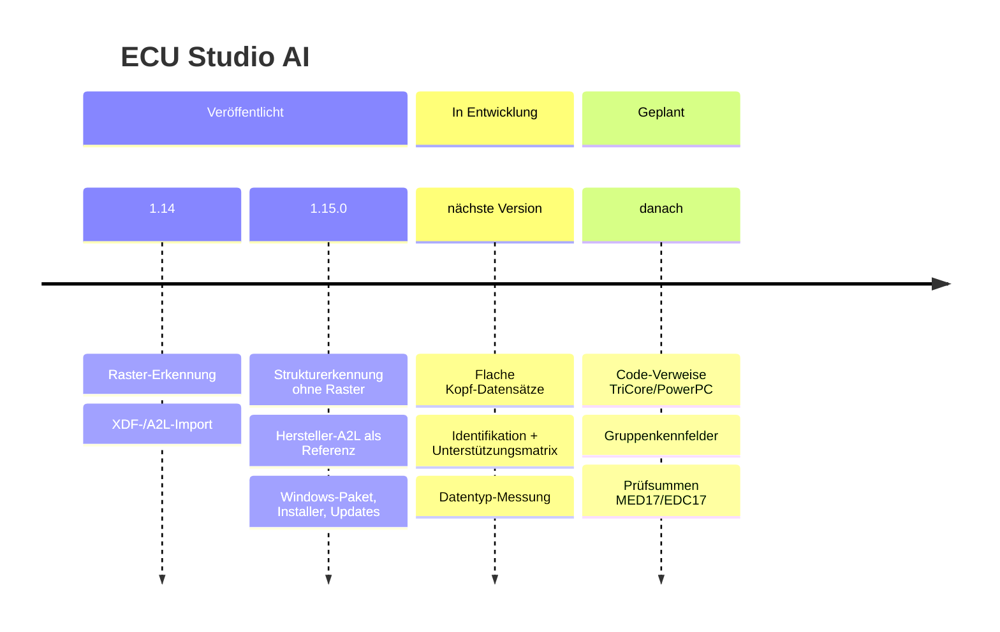

# 🗺️ Roadmap

**Was fertig ist, woran gearbeitet wird und was als Nächstes kommt.**

> [!NOTE]
> Die Roadmap nennt **Ziele, keine Versprechen**. Ein Punkt gilt erst als erledigt, wenn er gegen echte Referenzen
> **gemessen** ist – Messwerte stehen in [docs/PROGRESS.md](docs/PROGRESS.md) und [docs/ECU_SUPPORT.md](docs/ECU_SUPPORT.md).
> Termine gibt es bewusst nicht: Vieles hängt davon ab, ob passende Referenzdateien verfügbar sind.

| Zeichen | Bedeutung |
|:---:|---|
| ✅ | erledigt und veröffentlicht |
| 🔨 | in Entwicklung (im Hauptzweig, noch nicht veröffentlicht) |
| 📋 | geplant – Ansatz ist klar |
| 🔬 | in Untersuchung – Ansatz noch offen oder erst messen |
| 📦 | wartet auf Referenzdaten |
| 🚫 | bewusst nicht geplant |

---

## 🧭 Überblick

---

## 🎯 Schwerpunkte

Die acht wichtigsten Baustellen, nach Priorität. Jede Zeile nennt den **gemessenen Stand** und den **nächsten
überprüfbaren Schritt**.

| Priorität | Schwerpunkt | Stand heute | Nächster Schritt |
|:---:|---|---|---|
| 🔴 sehr hoch | **1. Genauere Kennfelderkennung** – weniger Fehlfunde, mehr exakte Kennfelder | 🔨 Kopf-Datensätze mit flachen Werten, Vorrang belegter Funde: auf den Testdaten Präzision 66–78 → 81–82 %, exakte Funde rund verdoppelt | 🔬 Code-Verweise für TriCore/PowerPC; Gruppenkennfelder; kleine Datensätze (2 × N) |
| 🔴 sehr hoch | **2. Moderne ECU-Familien** – EDC17, MED17, MD1, MG1, Simos mit echten Referenzen | ✅ EDC17CP09 validiert (1 Stand) · 🟡 MED17.1.62 nur Teil-Referenz · ⚪ MD1, MG1, Simos, MED17.5/17.7 ohne Daten | 📦 Original-BIN + passende A2L je Familie, möglichst 2 Softwarestände ([was gebraucht wird](docs/ECU_SUPPORT.md#was-für-die-offenen-varianten-gebraucht-wird)) |
| 🔴 sehr hoch | **3. Intelligente Kennfeldbenennung** – Funktion bestimmen, nicht nur Tabellen | ✅ Namen aus passender A2L/XDF (EPK geprüft) · ✅ Abgleich zwischen Softwareständen · ✅ Einheiten-Vorschläge für Achsen (MS43: 58 % Top-1) · ❌ kein Funktionsklassifikator: es gibt **0** unabhängig bestätigte Trainingskarten ([Modellkarte](docs/MODELLKARTE.md)) | 📋 Namen von einem Softwarestand mit A2L auf Schwesterstände übertragen (Achsen + Werte als Beleg, gemessen gegen deren A2L); erst danach ein Klassifikator, und nur mit Holdout-Messung |
| 🟠 hoch | **4. Professionelle Checksummen** – ECU-spezifisch, sichere Exporte | ✅ Korrektur nur mit geprüftem Profil, das auf dem **Original** stimmt · ✅ Suche unbekannter Layouts mit Zufallsniveau · ❌ keine geprüften Profile für MED17/EDC17, EDC15/16 | 📦 Profile nach den öffentlichen Algorithmen – nur mit echten Original-Dumps prüfbar |
| 🟠 hoch | **5. ORI/MOD-Vergleich** – Änderungen prüfen und zwischen Ständen übertragen | ✅ Byte- und Zellvergleich mit CSV-Export · ✅ Übertragung physikalischer Änderungen mit Vorschau und Einheitenprüfung | 📋 Vergleich direkt als Kennfeld-Liste mit Differenz-Heatmap; Übertragung gegen zwei echte Schwesterstände messen (MSD80: 6 Stände vorhanden) |
| 🟡 wichtig | **6. Schnellere Analyse** – große Dateien effizient | ✅ 2–5 MB in 10–40 s, Spitzenspeicher 36–190 MB (gemessen) | 📋 Datensatz-Suche vektorisieren (größter Zeitanteil); Fortschritt und Abbruch je Stufe |
| 🟡 wichtig | **7. Besseres Arbeitsinterface** – suchen, filtern, bearbeiten | ✅ Filter, Befehlspalette, Mehrfachbearbeitung, Unterstützungsmatrix | 📋 Filter nach Evidenzklasse und Konfidenz; Unterstützungsstatus als Hinweisleiste beim Öffnen; 🔬 englische Oberfläche |
| 🟡 wichtig | **8. Mehr Vertrauen und Sicherheit** – signiert, reproduzierbar, nachvollziehbar | ✅ SHA-256 + Build-Herkunft (`gh attestation verify`) · ✅ Benchmark-Werkzeug, Test/Entwicklung/Training getrennt · ✅ Update-Test vor jedem Release | 📋 Ed25519-signierte Updates · Code-Signatur (Zertifikat nötig) · reproduzierbarer Build |

---

## 🔨 In Entwicklung – nächste Version

Im Hauptzweig umgesetzt und gemessen, noch nicht als Release veröffentlicht.

| | Thema | Ergebnis (gemessen) |
|:---:|---|---|
| 🔨 | **Kopf-Datensätze mit flachen Werten** – Größe und Achsen aus dem Kopf, auch wenn die Werte konstant sind | EDC17CP09 exakt 157 → **463**/703, Präzision 71 → **85 %** |
| 🔨 | **Vorrang belegter Funde** und kein Ergebnislimit für sie | MSD85 *(Test)* 148 → **279**, EDC16C31 123 → **272** (Abdeckung **84 %**) |
| 🔨 | **Steuergeräte-Identifikation** – EPK, Hardware-/Softwarenummer, Teilenummer mit Fundstelle | 27 Referenzdateien: keine falsche Familie |
| 🔨 | **Unterstützungsmatrix** in der App (*Hilfe → Unterstützte Steuergeräte*) und in der Doku | vier Stufen: validiert · teilweise · experimentell · nicht validiert |
| 🔨 | **Benchmark misst den Datentyp** (Breite, Byte-Reihenfolge, Vorzeichen) und Speicher | z. B. EDC17CP09: 446 von 463 exakten Funden mit richtigem Typ |
| 🔨 | Weitere **unabhängige Testdaten**: 4 zusätzliche MSD80-Softwarestände | gleiche Hersteller-A2L, EPK geprüft |
| 🔨 | **Negativkontrollen**: Zufall, komprimiert, gelöscht | 0 Fehlalarme in 13 Dateien |

---

## 📋 Geplant

### Erkennung

| | Thema | Warum | Ziel / Messgröße |
|:---:|---|---|---|
| 🔬 | **Code-Verweise für TriCore (EDC17, MED17, MD1, MG1)** | Größter Hebel für moderne Bosch-Geräte. Direkte Adressladungen (`movh.a` + `lea`) treffen bei EDC17CP09 fast keine Kennfelder – der Zugriff läuft offenbar über Basisregister bzw. Zeigertabellen. | Anteil der A2L-Kennfelder, die über Code-Verweise gefunden werden |
| 🔬 | **Code-Verweise für PowerPC (MSD80/85, EDC16, MED9)** | Gleiches Prinzip, andere Adressierung (`lis`/`addi`, Small-Data-Bereiche über `r2`/`r13`) | wie oben, gemessen auf den Testdaten |
| 🔬 | **Gruppenkennfelder mit gemeinsamen Achsen** (Bosch MapG / COM_AXIS) | Bei EDC17CP09 135 der übrigen Fehlstellen. Ein reiner Strukturansatz wurde gemessen und verworfen (132 Funde, nur 24 exakt). | erst mit Code-Verweisen sinnvoll |
| 📋 | **Kleine Kopf-Datensätze (2 × N, 3 × N)** | 151 Kennfelder bei EDC17CP09 haben weniger als 4 Zeilen/Spalten | ohne mehr Fehlfunde in den Negativkontrollen |
| 📋 | **Kennfeld-Gruppen und Überwachungskopien** sichtbarer machen | Doppelte Ablage (z. B. Funktions- und Überwachungspfad) gemeinsam bearbeiten | Zwillinge je Gruppe, gegen A2L geprüft |
| 📋 | **Physikalische Skalierung vorschlagen** | Rohwerte → Einheiten (Drehzahl, Last, Temperatur) für Achsen ohne Definition | Top-1/Top-3-Treffer gegen A2L-Umrechnungen |

### Steuergeräte

| | Familie | Was fehlt |
|:---:|---|---|
| 📦 | **Bosch MED17.5 / 17.7 / MEVD17** | Original-BIN + passende A2L (EPK gleich) |
| 📦 | **Bosch MD1 / MG1** | Original-BIN + passende A2L/DAMOS, möglichst 2 Softwarestände |
| 📦 | **Bosch EDC17 außer CP09** (CP14, CP20, CP44–46, C46, C64, C74) | Original-BIN + A2L |
| 📦 | **Continental Simos 8–19, SID208/807/310/321** | Original-BIN + A2L |
| 📦 | **Siemens MSD81, MSV70/80 · Bosch EDC16C34/CP34** | Original-BIN + A2L |
| 📦 | **MED17.1.62** (Präzision) | vollständige A2L zu einem der 6 vorhandenen Stände |

### Sicherheit und Prüfsummen

| | Thema | Hinweis |
|:---:|---|---|
| 📦 | **Prüfsummen-Profile MED17/EDC17, EDC15/16** | Algorithmen sind öffentlich beschrieben, aber nur mit echten Original-Dumps prüfbar |
| 📋 | **Signierte Updates** (Ed25519 zusätzlich zu SHA-256 und Build-Herkunft) | Schlüssel bleibt beim Maintainer |
| 📋 | **Code-Signatur der Windows-Pakete** | beseitigt die SmartScreen-Warnung; braucht ein Code-Signing-Zertifikat |

### Bedienung

| | Thema |
|:---:|---|
| 📋 | Unterstützungsstatus direkt beim Öffnen einer Datei als Hinweisleiste |
| 📋 | Vergleich „erwartete vs. gefundene Kennfelder“ je Familie – aus der gemessenen Matrix statt aus Listen |
| 🔬 | Englische Oberfläche |

---

## ✅ Erledigt

<b>1.15.0</b> (21.10.2026) – Strukturerkennung, Hersteller-Referenzen, Windows-Paket

 

- ✅ Kennfeldsuche ohne Raster: Zeilenabstand, Achsen-Arrays, Kopf-Datensätze, Code-Verweise (C16x, 68k, SH-2, HC11, 8051)
- ✅ Lernmodell für Datenmuster, **gemessene Konfidenz** je Beweisart
- ✅ A2L-Datensätze mit gespeicherten Achsen (STD/COM/FIX_AXIS), **EPK-Prüfung** auch bei Segmentkopplung
- ✅ Benchmark gegen **Hersteller-A2L** (EDC17CP09, MSD80/85, EDC16, ME9, MS45) mit Test/Entwicklung/Training
- ✅ Flash-Preflight je Byte, Zwillingskennfelder, Prüfsummen-Suche und Korrektur mit Vorschau
- ✅ Windows-Paket ohne Python, Installer, automatische Updates mit Sicherung, Rollback und Wiederherstellen
- ✅ Release-Workflow mit echtem Update-Test auf Windows Server 2022/2025

<b>1.14 und früher</b> – Editor, Definitionen, Projekte

 

- ✅ BIN-Editor mit Hex-, Tabellen- und 3D-Ansicht, Versionsstände, Änderungsbericht
- ✅ XDF-, A2L-, RomRaider- und CSV-Import, Definitions-Register
- ✅ Projekte mit Originalschutz und Wiederherstellung

---

## 🚫 Bewusst nicht geplant

| | Warum |
|---|---|
| 🚫 **Automatische Stage-1-/Leistungssteigerung** | Änderungen an Kennfeldern brauchen fachliches Urteil am konkreten Fahrzeug. |
| 🚫 **Flashfreigabe** oder „flashbereit“-Kennzeichnung | Kein Ergebnis der App ersetzt die Prüfung mit einem geeigneten Werkzeug. |
| 🚫 **Umgehen von Schutz- und Sicherheitsfunktionen** (Wegfahrsperre, Abgas, Plausibilitätsprüfungen) | rechtlich und sicherheitlich nicht vertretbar |
| 🚫 **Zerlegen kommerzieller Werkzeuge** (z. B. WinOLS) | Vergleiche nur von außen ([Vergleich quelloffener Werkzeuge](docs/OPEN_SOURCE_VERGLEICH.md)) |
| 🚫 **Import von WinOLS-Projekten (`.ols`)** ohne verifizierbares Lesen | Lieber klar abweisen als falsch lesen. |
| 🚫 **Firmware im Repository** | Originaldateien bleiben lokal; veröffentlicht werden nur Zählwerte. |

---

## 🤝 Mithelfen

Der größte Fortschritt entsteht durch **Referenzpaare**: eine Originaldatei und die **passende** Definition
(Hersteller-A2L oder vollständige XDF) desselben Softwarestands. Wer solche Paare rechtmäßig nutzen darf, kann mit
`python -m ecu_studio.tools.benchmark_suite` lokal messen und **nur die Zahlen** teilen – siehe
[CONTRIBUTING.md](CONTRIBUTING.md). Bitte **keine Original-Firmware** hochladen.

 
<a href="README.md">← zurück zur README</a> · <a href="CHANGELOG.md">CHANGELOG</a> · <a href="docs/PROGRESS.md">Fortschritt</a> · <a href="docs/ECU_SUPPORT.md">Steuergeräte</a>

