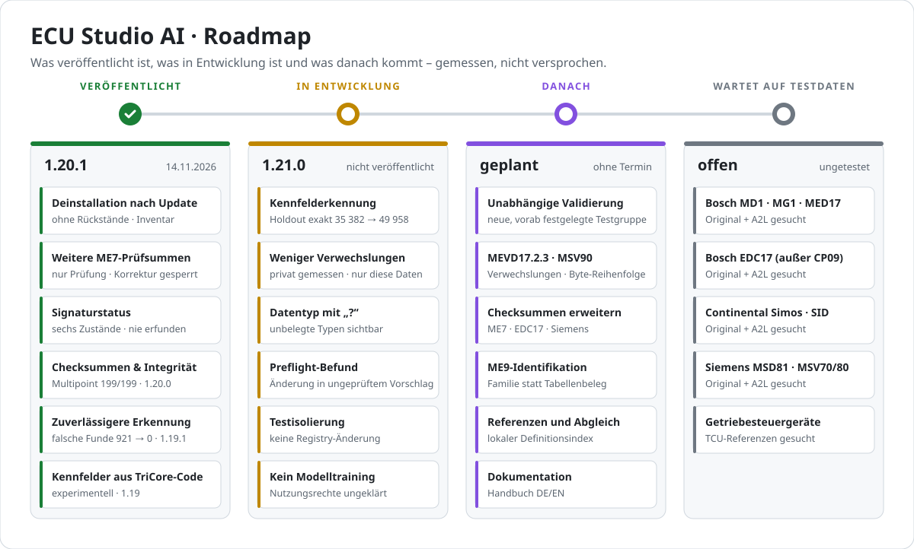
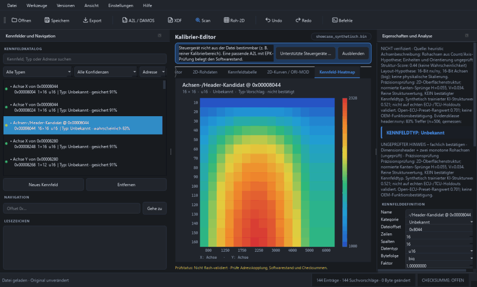
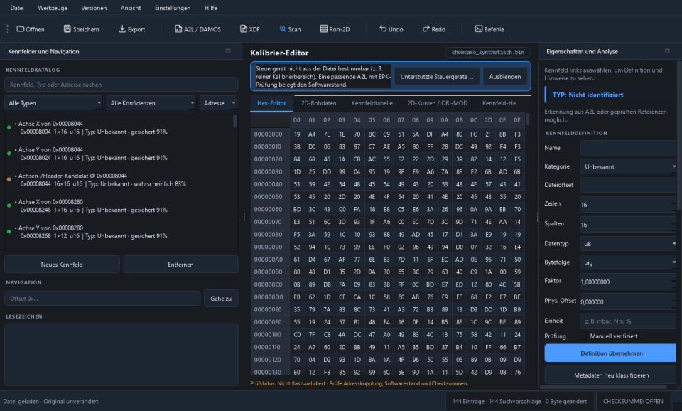
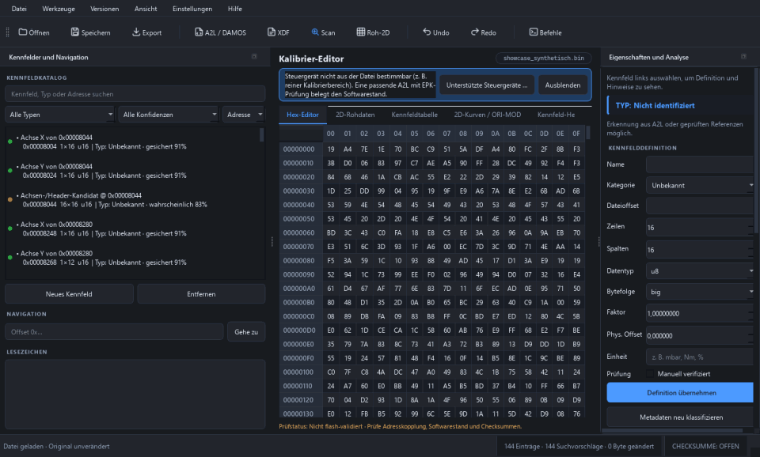
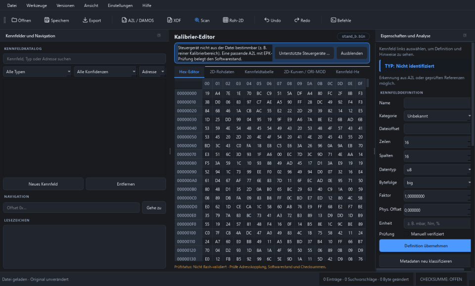
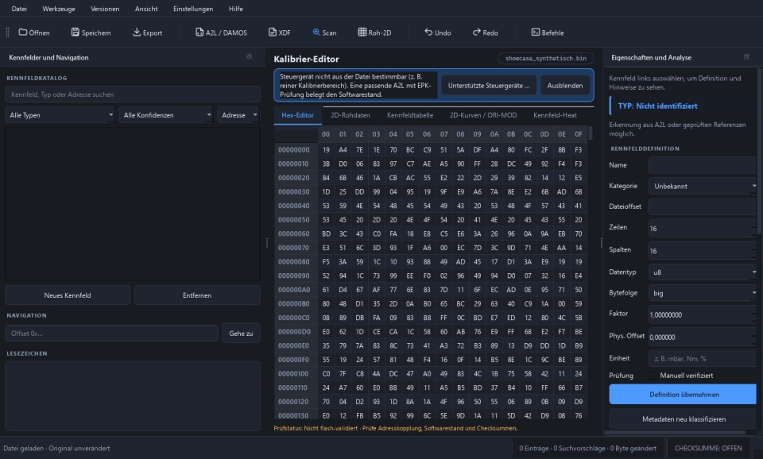
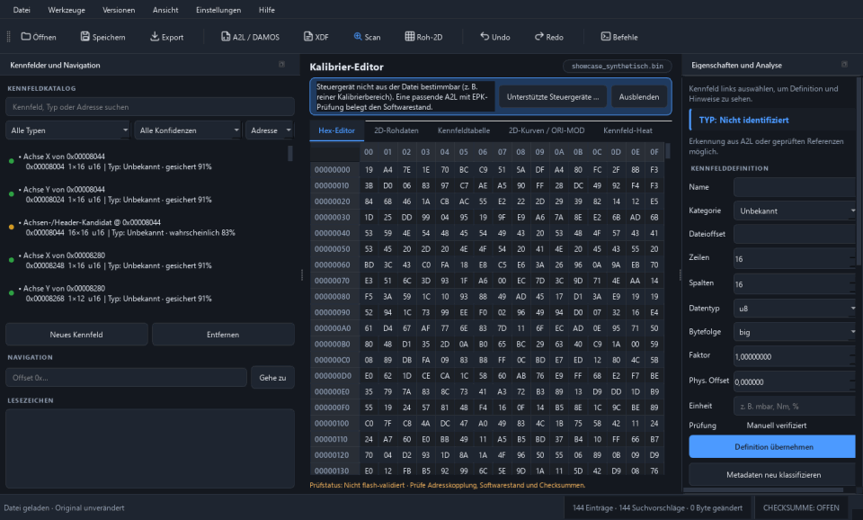
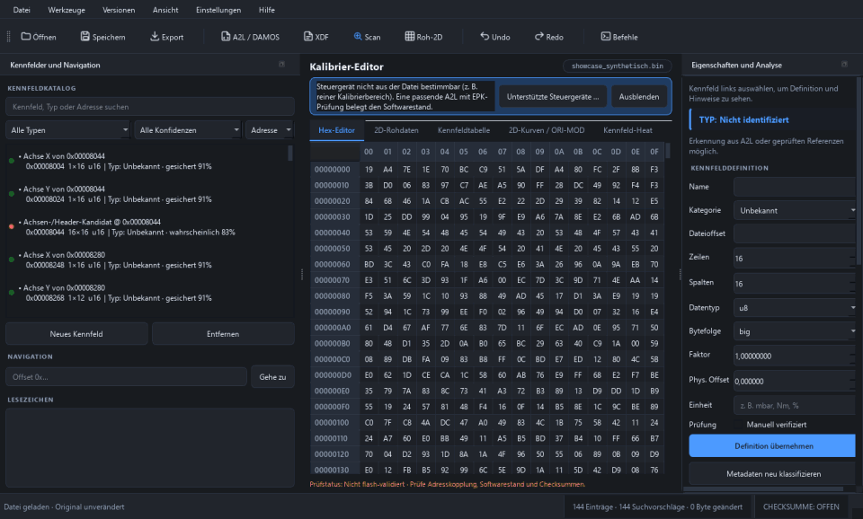
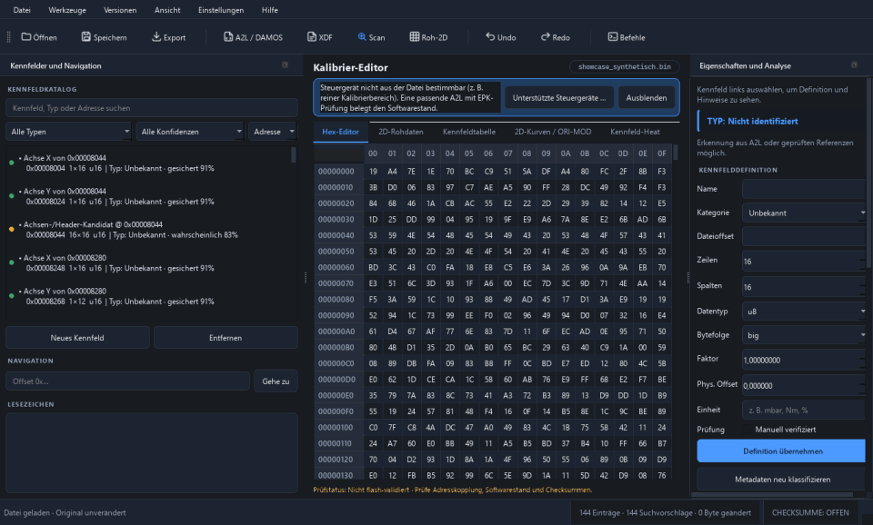
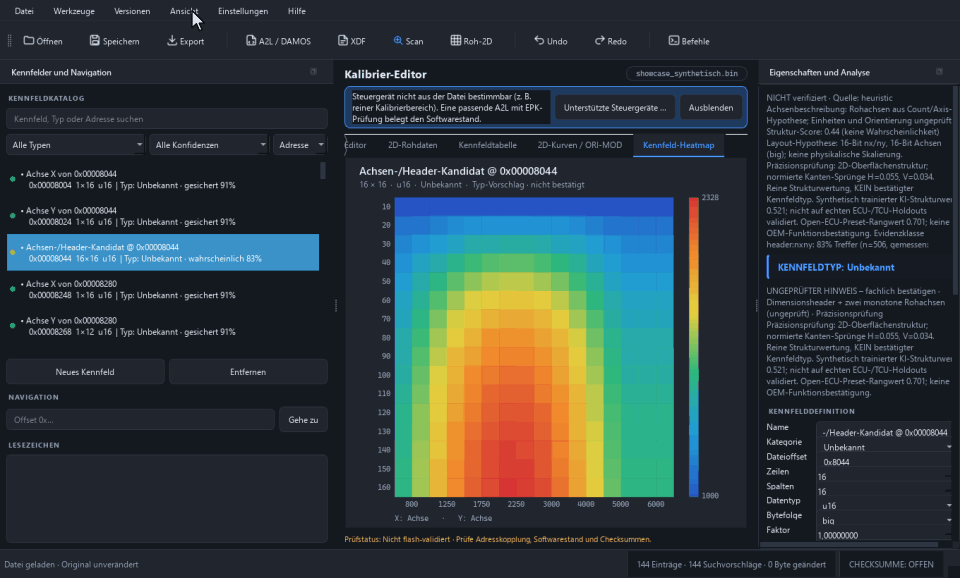

<picture>
  <source media="(prefers-color-scheme: dark)" srcset="docs/images/roadmap-dark.svg">
  
</picture>

  

&nbsp;

&nbsp;

# Roadmap

Stand: 25.11.2026. Diese Seite beschreibt, was veröffentlicht ist, was in Entwicklung ist und was als Nächstes
geplant ist. Grundlage sind Code, Tags, [CHANGELOG](CHANGELOG.md), Release Notes, Pull Requests, Tests und
Prüfberichte.

| | Version | Status |
|---|---|---|
| 🟢 | **[1.20.1](https://github.com/PCTestAdmin/ECU-Studio-AI/releases/tag/v1.20.1)** · 14.11.2026 | **aktuelle Version** ([Release Notes](docs/RELEASE_NOTES_1.20.1.md)) |
| 🧪 | **[1.21.0-rc1](https://github.com/PCTestAdmin/ECU-Studio-AI/releases/tag/v1.21.0-rc1)** · 20.11.2026 | **veröffentlichte Vorabversion** (GitHub-Pre-Release, nicht „Latest“) für freiwillige Tests, keine stabile Version; der stabile Update-Kanal bietet sie nicht an ([Release Notes](docs/RELEASE_NOTES_1.21.0-rc1.md)) |
| 📋 | **1.21.0** | **geplante stabile Version, nicht veröffentlicht**; ihr Inhalt ist bisher als Vorabversion 1.21.0-rc1 veröffentlicht ([PR #29](https://github.com/PCTestAdmin/ECU-Studio-AI/pull/29), [Entwicklungsbericht](docs/ENTWICKLUNG_1.21.0.md)) |
| 🟠 | **Nach 1.21.0-rc1** | **in Entwicklung, nicht veröffentlicht**: nächste Generation der Kennfelderkennung (Zweig `feat/post-rc1-recognition-nextgen`, Draft-PR, [Bericht](docs/ENTWICKLUNG_NEXTGEN.md)); als Vorabversion **1.21.0-rc2 vorbereitet, nicht freigegeben** ([Entscheidungsvorlage](docs/RELEASE_READINESS_RC2.md)) |

Termine gibt es bewusst nicht: Ein Punkt gilt erst als fertig, wenn er an echten, rechtmäßig nutzbaren Daten
gemessen und veröffentlicht ist.

**Inhalt:** [Statusbegriffe](#statusbegriffe) · [A. Versionen](#a-versionen) ·
[B. Erkennungsgüte 1.20.1 → 1.21.0-rc1](#b-erkennungsgüte-1201--1210-rc1-vorabversion) ·
[C. Funktionen und Stand](#c-funktionen-und-stand) · [D. Plan](#d-plan) ·
[E. Nicht geplant, fehlende Daten](#e-bewusst-nicht-geplant-und-fehlende-daten) ·
[F. Langfristiges Ziel](#f-langfristiges-ziel-automatische-kennfeldidentifikation-und-physikalische-skalierung)

## Statusbegriffe

| Status | Bedeutung |
|---|---|
| ✅ **veröffentlicht** | In einem GitHub-Release enthalten |
| 🧪 **Vorabversion** | In der veröffentlichten Vorabversion 1.21.0-rc1 enthalten (GitHub-Pre-Release, nie „Latest“), noch in keinem stabilen Release |
| 🟠 **implementiert, nicht veröffentlicht** | Im Entwicklungszweig umgesetzt und getestet, in keinem Release und keiner Vorabversion (derzeit: Zweig nach 1.21.0-rc1, Draft-PR) |
| ⚗️ **experimentell** | Ausdrücklich als ungeprüft/experimentell gekennzeichnet (veröffentlicht oder nicht); Ergebnisse sind Vorschläge |
| 🟡 **teilweise** | Veröffentlicht, deckt aber nur einen Teil ab (welcher, steht in der Zeile) |
| 📋 **geplant** | Noch nicht begonnen oder ohne lauffähigen Stand |
| 🚫 **nicht unterstützt** | Nicht vorhanden; bei 🚫 in [E](#e-bewusst-nicht-geplant-und-fehlende-daten) bewusst ausgeschlossen |

---

## A. Versionen

Die GitHub-Releases beginnen mit 1.15.0. Ältere Stände wurden lokal entwickelt und nicht als Release
veröffentlicht; sie stehen nur im [CHANGELOG](CHANGELOG.md).

| Version | Datum | Status | Schwerpunkte | Belege |
|---|---|---|---|---|
| **[1.21.0-rc1](https://github.com/PCTestAdmin/ECU-Studio-AI/releases/tag/v1.21.0-rc1)** | 20.11.2026 | 🧪 Vorabversion veröffentlicht (Pre-Release, nicht „Latest“) | Vorabversion des Stands unten zum Praxistest; Testkanal für Vorabversionen (stabiler Kanal bietet sie nie an), Versionsschema `X.Y.Z-rcN`, Release-Workflow nur als Pre-Release mit Schutzprüfungen; TriCore-Vorzeichen nur bei einheitlichen Ladebefehlen belegt | [Notes](docs/RELEASE_NOTES_1.21.0-rc1.md), [PR #29](https://github.com/PCTestAdmin/ECU-Studio-AI/pull/29) |
| **Nach 1.21.0-rc1** | – | 🟠 in Entwicklung, nicht veröffentlicht | Nächste Generation: Codebeleg aus direkt geladenen Werten gegen Datenmuster-Fehlfunde, Funktionsebene (Prototyp, Status Bestätigt/Stark gestützt/Vermutet/Unbekannt), Datentyp-Status je Eigenschaft und Umrechnung mit Herkunft; nicht unabhängig validiert | [Bericht](docs/ENTWICKLUNG_NEXTGEN.md) |
| **1.21.0** | – | 📋 stabile Version geplant; Inhalt als 1.21.0-rc1 veröffentlicht | Kennfelderkennung mit privaten A2L-/HEX-Referenzdaten: verlagerte TriCore-Kalibrierung, Zeigertripel, gemischte Achsbreiten, Wertebreite aus Datensatzgrenzen, widersprochene Datenmuster verworfen, Datentyp mit „?“, unbelegte Byte-Reihenfolge sichtbar, Prüfhilfen (Filter, fehlender Beleg, Lesarten nebeneinander), gelber Preflight-Befund für ungeprüfte Vorschläge; Testisolierung der Einstellungen (Registry) | [PR #29](https://github.com/PCTestAdmin/ECU-Studio-AI/pull/29), [Bericht](docs/ENTWICKLUNG_1.21.0.md) |
| **[1.20.1](https://github.com/PCTestAdmin/ECU-Studio-AI/releases/tag/v1.20.1)** | 14.11.2026 | ✅ veröffentlicht, aktuelle stabile Version | Deinstallation nach In-App-Update ohne Rückstände (Inventar), Updates von Installer-Installationen über den geprüften Installer, weitere ME7-Prüfsummen (nur Prüfung), Signaturstatus mit sechs Zuständen, Release-Prüfungen | [Notes](docs/RELEASE_NOTES_1.20.1.md), PR [#24](https://github.com/PCTestAdmin/ECU-Studio-AI/pull/24)–[#28](https://github.com/PCTestAdmin/ECU-Studio-AI/pull/28) |
| **1.20.0** | 11.11.2026 | ✅ veröffentlicht | Checksummen & Integrität mit fünf Status, Bosch-Multipoint unabhängig belegt (199/199), sichere Korrektur, getrennte Preflight-Stufen, stabiler Definitionseditor | [Notes](docs/RELEASE_NOTES_1.20.0.md), PR [#19](https://github.com/PCTestAdmin/ECU-Studio-AI/pull/19)–[#22](https://github.com/PCTestAdmin/ECU-Studio-AI/pull/22) |
| **1.19.1** | 08.11.2026 | ✅ veröffentlicht | Architektur nur mit zwei Merkmalen, weniger Fehlfunde (offene Firmware: nachweislich falsche Funde 921 → 0), A2L-Zwischenspeicher, Dateiversion | [Notes](docs/RELEASE_NOTES_1.19.1.md), PR [#16](https://github.com/PCTestAdmin/ECU-Studio-AI/pull/16)–[#18](https://github.com/PCTestAdmin/ECU-Studio-AI/pull/18) |
| **1.19.0** | 04.11.2026 | ✅ veröffentlicht | Drei Erkennungsebenen, Art des Belegs statt Prozentzahl, TriCore-Programmcode (experimentell), Identifikation mit Stufe, Prüfliste, Lernmodelle ohne Freigabe entfernt | [Notes](docs/RELEASE_NOTES_1.19.0.md), [Validierung](docs/VALIDIERUNG_1.19.0.md), PR [#14](https://github.com/PCTestAdmin/ECU-Studio-AI/pull/14) |
| **1.18.2** | 01.11.2026 | ✅ veröffentlicht | Sicherheitskorrektur der Bildprüfung im Firmware-Schutz, Programmsymbol in kleinen Größen | PR [#12](https://github.com/PCTestAdmin/ECU-Studio-AI/pull/12), [#13](https://github.com/PCTestAdmin/ECU-Studio-AI/pull/13) |
| **1.18.1** | 31.10.2026 | ✅ veröffentlicht | Programmsymbol, Firmware-Schutz prüft Bilder strukturell | [CHANGELOG](CHANGELOG.md) |
| **1.18.0** | 31.10.2026 | ✅ veröffentlicht | Offline zuerst (Update-Suche ab Werk aus), lokale Referenzsuche, Definition bearbeiten, XDF-Export, Firmware-Schutz als Git-Hooks, TriCore-Interpolationsaufrufe (MSD80) | [Analyse](docs/ANALYSE_2026-10-31.md), PR [#9](https://github.com/PCTestAdmin/ECU-Studio-AI/pull/9)–[#11](https://github.com/PCTestAdmin/ECU-Studio-AI/pull/11) |
| **1.17.0** | 24.10.2026 | ✅ veröffentlicht | Offenes Kennfeldpaket v2 mit Vorschau, Herkunft und Undo; reproduzierbare Referenzvalidierung | [Kennfeldpaket](docs/MAP_PACK.md), PR [#6](https://github.com/PCTestAdmin/ECU-Studio-AI/pull/6), [#7](https://github.com/PCTestAdmin/ECU-Studio-AI/pull/7) |
| **1.16.4** | 23.10.2026 | ✅ veröffentlicht | Gemeinsame Achsen, Softwarestand-Vergleich mit Werteübernahme, Projektbibliothek, Fehlfundanalyse, neuere Projekte verlustfrei laden | [Analyse](docs/ANALYSE_2026-10-23.md), PR [#2](https://github.com/PCTestAdmin/ECU-Studio-AI/pull/2), [#3](https://github.com/PCTestAdmin/ECU-Studio-AI/pull/3) |
| **1.16.3** | 22.10.2026 | ✅ veröffentlicht | Updater-Arbeitsordner, Wiederholen bei Dateisperren | [CHANGELOG](CHANGELOG.md) |
| **1.16.2** | 22.10.2026 | ✅ veröffentlicht | EDC16/EDC17-Prüfsummenblöcke (Prüfung; Korrektur nur mit OEM-Nachweis) | PR [#1](https://github.com/PCTestAdmin/ECU-Studio-AI/pull/1) |
| **1.16.1** | 22.10.2026 | ✅ veröffentlicht | Update aus der App repariert | [CHANGELOG](CHANGELOG.md) |
| **1.16.0** | 22.10.2026 | ✅ veröffentlicht | Kopf-Datensätze und Datensatzketten, parallele Suche (2–4× schneller), englische Oberfläche, ORI/MOD-Vergleich, Namensübertragung, Prüfsummen ME7/MED9/ME9, Unterstützungsmatrix, vorherige Version wiederherstellen | [Analyse](docs/PROGRESS.md) |
| **1.15.0** | 21.10.2026 | ✅ veröffentlicht | Erstes Release: Kennfeldsuche ohne Raster, A2L mit Achsen und EPK-Prüfung, Flash-Vorabprüfung, Windows-Paket ohne Python, Installer, Updates mit Rücksicherung | [CHANGELOG](CHANGELOG.md) |
| 1.9.0 – 1.11.0 | 16.–17.10.2026 | kein Release | Lokale Entwicklungsstände: 3D-Ansicht, TCU-Kurvenscanner, Projektwerkzeuge, synthetisch trainiertes Modell (seit 1.19.0 entfernt) | [CHANGELOG](CHANGELOG.md) |

---

## B. Erkennungsgüte 1.20.1 → 1.21.0-rc1 (Vorabversion)

> [!IMPORTANT]
> **Der Stand der letzten Spalte ist als Vorabversion 1.21.0-rc1 veröffentlicht, nicht als stabile Version.**
> Die Zahlen beschreiben den Entwicklungszweig von 1.21.0 (PR #29, Funde identisch mit rc1), gemessen an privaten A2L-/HEX-Referenzdaten eines Datengebers (163 Abbilder, 80 A2L, BMW-Linien der
> Familien ME9, MEVD17.2, MEVD17.2.3, MSD80, MSV90). Sie gelten **nur für diese Daten** und nur für
> **verifizierbare 2D-Kennfelder** (A2L-Objekte, deren Lage und Form sich am Abbild prüfen lassen). Die Daten
> bleiben lokal; mit ihnen wurde **kein Modell trainiert** (Nutzungsrechte dafür ungeklärt).

**Exakt** = richtiger Start, richtige Form und Zellbreite. **Verwechslung** = Fund überdeckt ein Referenzkennfeld,
ohne es zu treffen. Die **Präzision** ist nicht allgemein bestimmbar: Funde außerhalb der A2L lassen sich nicht
bewerten („nicht bewertbar“), und die A2L beschreibt nicht jede Tabelle.

### Entwicklungsdaten (58 Abbilder, 52 508 verifizierbare Kennfelder; alle Regeln nur hier abgestimmt)

| | 1.20.1 | Runde 1 | Runde 3 | Phase 4 | Phase 5 |
|---|---:|---:|---:|---:|---:|
| exakt | 20 517 | 30 735 | 32 058 | 32 058 | 32 058 |
| Verwechslungen | 9 020 | 7 912 | 5 316 | 5 316 | 5 316 |
| Datentyp richtig unter exakten | 77,0 % | 96,3 % | 95,8 % | 95,8 % | 95,8 % |
| Vorzeichenfehler / Byte-Reihenfolge falsch | 1 890 / 2 829 | 1 128 / 21 | 1 326 / 20 | 1 326 / 20 | 1 326 / 20 |
| falscher Typ **ohne** „?“-Kennzeichnung | – | – | 235 ¹ | **0** | **0** |

¹ Abgeleitet: gleiche Funde und Typen wie Phase 4, ohne die „?“-Regeln von Phase 4. Phase 4 ändert keine Funde;
sie hält nicht belegte Vorzeichen als Alternative offen (41 % der exakten Funde tragen ein „?“). Phase 5 ändert auf
den Entwicklungsdaten nichts (alle 58 Abbilder fundgleich); ihre Regel betrifft nur Abbilder ohne einheitliche
Byte-Reihenfolge.

### Holdout (105 Abbilder, 91 370 verifizierbare Kennfelder; vor der Arbeit nach Linien getrennt)

| | 1.20.1 | Runde 1 | Runde 3 | Phase 5 |
|---|---:|---:|---:|---:|
| exakt | 35 382 | **49 958** | 52 701 | 52 701 |
| Verwechslungen | 16 820 | **15 518** | 10 743 | 10 743 |
| Datentyp richtig unter exakten | 80,5 % | **93,3 %** | 92,6 % | 92,6 % |
| Vorzeichenfehler / Byte-Reihenfolge falsch | 2 639 / 4 270 | **2 017 / 1 336** | 2 486 / 1 436 | 2 486 / 1 436 |
| davon Byte-Reihenfolge falsch **mit** „?“ | – | – | 0 | **1 399** |

- **Runde 1 war die erste und einzige unabhängige Holdout-Messung.** Danach waren die Holdout-Linien bekannt;
  Runde 3 ist nur eine **Regressionsprüfung** (nichts wurde am Holdout abgestimmt), keine Bestätigung. Phase 4 und
  Phase 5 wurden ebenso je einmal geprüft: Funde wie Runde 3. Phase 5 macht die unbelegte Byte-Reihenfolge sichtbar
  (MSV90), ohne eine Reihenfolge festzulegen. Eine neue unabhängige Testgruppe realer Steuergeräte gibt es nicht
  (siehe [E](#e-bewusst-nicht-geplant-und-fehlende-daten)).
- **Externe Stichprobe** (Phase 5, synthetisch): TT-DEMO-1 aus dem MIT-lizenzierten Projekt Tuners Toolkit, ein
  erfundenes Steuergerät mit A2L und HEX. 4 Kennfelder: 1.20.1 und 1.21.0 je 1 exakt, Verwechslungen 2 → 1.
  Statistisch ohne Aussage; zeigt nur, dass Import und Abgleich mit einer fremden A2L funktionieren.
- **Wiedererkennung über Versionen** (Namensübertragung, Holdout, Runde 1): falsch übertragene Namen 1 832 → 210,
  richtig übertragene 91,4 % → 90,7 %. Übertragene Namen bleiben ungeprüfte Vorschläge.
- **Negativbestand** (7 offene FOME-/rusEFI-/Speeduino-Stände ohne Kennfelder, jeder Fund ist ein Fehlfund):
  875 → 549 (Runde 3) → 549 (Phase 4) → 549 (Phase 5); „sicher falsch“ (Füllbytes, Text, Code) 0.
- **Laufzeit** (Leistungssatz, 15 Abbilder nacheinander): 160,3 s → 152,2 s (Runde 3) → 144,4 s
  (Phase 4; Runde 3 am selben Tag neu gemessen: 141,8 s, Unterschied ist Messstreuung) → 149,6 s (Phase 5),
  Spitzenspeicher 431 MB unverändert. Messungen unter Fremdlast streuen bis 17 %; eine Wiederholung auf einem
  unbelasteten Rechner vor dem Release steht aus.
- **Regressionen:** MS43 (Community-XDF) 197 → 196 exakt in Runde 3, in Phase 4 behoben (197); Regressionssatz in
  Phase 5 unverändert (15 Fälle). MEVD17.2.3-Vollflashs haben auf dem Holdout noch mehr Verwechslungen als 1.20.1
  (3 042 → 3 297); die Entwicklungsdaten zeigen das Muster nicht, eine Abhilfe braucht Entwicklungsdaten dieser
  Linie. MSV90-Byte-Reihenfolge weiter ohne Beleg, aber seit Phase 5 als offen gekennzeichnet.
- **Unsicherheit bleibt sichtbar:** Funde sind Vorschläge mit Belegstufe; nicht belegte Datentypen tragen ein „?“
  mit Grund; Änderungen in ungeprüften Vorschlägen erzeugen einen gelben Preflight-Befund.

Einzelheiten je Linie, verworfene Ansätze und Grenzen: [docs/ENTWICKLUNG_1.21.0.md](docs/ENTWICKLUNG_1.21.0.md).
Die öffentlichen Messungen bis 1.19.1 an anderen Referenzen: [docs/ECU_SUPPORT.md](docs/ECU_SUPPORT.md),
[docs/PROGRESS.md](docs/PROGRESS.md).

---

## C. Funktionen und Stand

| Bereich | Status | Seit | Was es heute kann | Grenzen |
|---|---|---|---|---|
| **Automatische Kennfelderkennung** | ✅ veröffentlicht · 🧪 Ausbau in 1.21.0-rc1 · 🟠 nächste Generation | 1.15.0, Ebenen 1.19.0 | Code-Verweise (C16x, TriCore, 68k, SH-2, HC11, 8051), Datensätze mit Anzahl und Achsen, Achsen-Arrays, Datenmuster; jeder Fund mit Belegstufe. 🟠 Nächste Generation: direkt geladene Werte widerlegen Datenmuster-Funde | Funde sind Geometrie-Hypothesen, nicht unabhängig validiert; TriCore-Code ⚗️; Präzision nur für einzelne Referenzen bekannt |
| **A2L / DAMOS** | ✅ veröffentlicht · 🧪 Korrekturen in 1.21.0-rc1 · 🟠 Umrechnung mit Herkunft, A2L-Funktionen | 1.15.0 | Kennfelder, Kennlinien und Werte mit Achsen und Umrechnung, EPK-Prüfung gegen die Datei, Zwischenspeicher | Keine vollständige ASAP2-Implementierung; 1.21.0: verdoppelte Anführungszeichen, VAL_BLK mit `NUMBER` |
| **Weitere Definitionen** | ✅ veröffentlicht | ≤ 1.14, Pakete 1.17.0 | XDF (Import, Export mit Rückimport-Prüfung), RomRaider, CSV, HEX/S19, offenes Kennfeldpaket | XDF-Export nur für Tabellen, Kennlinien, Konstanten |
| **Editor und Visualisierung** | ✅ veröffentlicht | ≤ 1.14 | Tabelle, Heatmap, 2D, 3D, Hex, Speicheratlas, ORI/MOD-Vergleich, Definition bearbeiten mit Vorschau, Undo, Projektstände | Original bleibt unverändert; Änderungen als Ebene |
| **Steuergeräte-Identifikation** | ✅ veröffentlicht · 🟡 teilweise | 1.16.0, Stufen 1.19.0 | Familie und Softwarestand mit Stufe und Grund | Siemens-Familien ohne Klartext „unbekannt“; ME9-Referenz nicht erkannt; 1.21.0-rc1 🧪: EPK verfeinert Plattformfamilie |
| **Wiedererkennung über Versionen** | ✅ veröffentlicht · 🧪 Ausbau in 1.21.0-rc1 | 1.16.0 / 1.16.4 | Softwarestand-Vergleich (auch verschoben), Namensübertragung, Werteübernahme mit Vorschau | Übertragene Namen sind Vorschläge; 1.21.0: flache Blöcke nur mit Ankern |
| **KI / Lernmodelle** | ⚗️ eingeschränkt | vor 1.15.0; Rückzug 1.19.0 | Zwei kleine Modelle mit geklärter Herkunft sortieren Strukturvorschläge nur um (Strukturprüfung aus synthetischen Flächen; Reihung aus rusEFI-Quellen, GPL-3.0) und entfernen keine; Modellsperre für überwacht trainierte Typmodelle | Lernmodell für Datenmuster und angezeigte Trefferquoten 1.19.0 entfernt (Herkunft nicht nachweisbar); kein Training mit den 1.21.0-Referenzdaten ([Modellkarte](docs/MODELLKARTE.md)) |
| **Getriebesteuergeräte (TCU)** | ⚗️ experimentell | 1.9.0 | Opt-in-Suche nach 1D-Wortpaar-Kurven, Familienhinweise (u. a. GS20) | Keine validierte TCU-Kennfelderkennung, keine TCU-Referenzdaten |
| **Checksummen** | ✅ veröffentlicht · 🟡 teilweise | 1.15.0, System 1.20.0 | Bosch-Multipoint (ME7.x, ME9, MED9) prüfen und korrigieren (199/199 Herstellerwerte); weitere ME7-Prüfsummen und EDC16/EDC17-Blöcke nur prüfen | Keine Datei bisher vollständig abgedeckt; Siemens/Continental „nicht unterstützt“ ([Details](docs/CHECKSUMMEN.md)) |
| **Signaturprüfung** | 🟡 teilweise | 1.20.1 | Herstellersignaturen mit sechs getrennten Status; „gültig“ nur mit vertrauenswürdigem Schlüssel | Für keine Familie liegt ein solcher Schlüssel vor; keine Funktion erzeugt, entfernt oder umgeht Signaturen |
| **Firmware-Schutz und Flash-Sicherheit** | ✅ veröffentlicht | 1.18.0 – 1.18.2 | Git-Hooks gegen Firmware im Repository, strukturelle Bildprüfung, Preflight mit getrennten Stufen; 1.21.0-rc1 🧪: Befund für Änderungen in ungeprüften Vorschlägen | **Keine Flashfreigabe**; Pixelinhalte von Bildern nicht prüfbar ([Details](docs/FIRMWARE_PROTECTION.md)) |
| **Updates und Deinstallation** | ✅ veröffentlicht · 🧪 Testkanal in der Vorabversion 1.21.0-rc1 | 1.15.0, Offline zuerst 1.18.0, Inventar 1.20.1 | Update-Suche ab Werk aus, SHA-256 und Build-Herkunft, Rücksicherung, Deinstallation nach Inventar | Signierte Updates eingebaut, aber ohne Schlüssel inaktiv; EXE nicht code-signiert (SmartScreen); Updates mit dem Updater von 1.20.0 hinterlassen Dateien; 1.21.0-rc1: stabiler Kanal bietet nie eine Vorabversion an, Testkanal nur nach Rückfrage, ein Release mit widersprüchlicher Markierung wird in keinem Kanal angeboten |
| **Leistung** | ✅ veröffentlicht · 🧪 1.21.0-rc1 | 1.16.0 | Alle CPU-Kerne; 1.21.0: Leistungssatz 160 s → 144 s bei 48 % mehr exakten Funden | Messstreuung zwischen Tagen bis 7 %; 10-MB-Vollflashs brauchen rund 18 s |
| **Funktionsebene** | 🟠 Prototyp, nicht veröffentlicht | – | Funktion je Kennfeld nur aus A2L `FUNCTION` oder über Beziehungen (gemeinsame Achse, Programmcode, Nachbar nur zwischen Tabellen derselben Funktion) zu Kennfeldern mit bekannter Funktion; Status Bestätigt / Stark gestützt / Vermutet / Unbekannt, Widersprüche und Belege mit Herkunft; Funktionsgruppen ohne Namen | Ohne Definition bleibt jede Funktion „Unbekannt“; Namen werden nie aus Werten abgeleitet; unter harten Aufteilungen geprüft, nur an zwei BMW-Linien der Entwicklungsdaten, nicht unabhängig validiert |
| **Code-Datenfluss (TriCore)** | 🟠 ⚗️ experimentell, nicht veröffentlicht | – | Eingangsgrößen und Ergebnisort der Interpolationsaufrufe in begrenzten Fenstern; Beziehungen gleiche Routine, gleiche Ergebnisvariable, Datenfluss; offene Fälle mit Grund | Nur TriCore; keine PowerPC/C16x-Datenflussanalyse; an zwei Vollabbildern gegen A2L-Messgrößen geprüft |
| **Datentyp und Umrechnung mit Herkunft** | 🟠 nicht veröffentlicht | – | Wertebreite, Vorzeichen, Byte-Reihenfolge je mit Status (bestätigt, codebelegt, abgeleitet, wertgleich, alternativ, unbestimmt), Quelle und Widerspruch; Faktor/Offset/Einheit mit Quelle (A2L COMPU_METHOD) | Erkannte Kennfelder bleiben Rohwerte; nicht unterstützte A2L-Umrechnungen ebenso; A2L-Grenzen nur als Hinweis; „wertgleich“ ist kein Typbeleg |
| **Oberfläche** | ✅ veröffentlicht | – | Prüfliste, Belegstufen, Filter, Detailansicht; 1.21.0-rc1 🧪: Datentyp mit „?“, Filter „Datentyp nicht belegt“ und „Überschneidung“, fehlender Beleg je offener Frage, Lesarten derselben Bytes nebeneinander, Prüfliste nach Prüfgrund, geprüfte Einträge hervorgehoben | Windows 10/11; Lesarten zeigen Rohwerte, keine Bewertung |
| **Sprachen** | ✅ veröffentlicht | 1.16.0 | Deutsch und Englisch (Systemsprache als Standard) | Dokumentation überwiegend Deutsch |
| **Tests und CI/CD** | ✅ veröffentlicht · 🧪 Isolierung in 1.21.0-rc1 | – | pytest unter Python 3.11/3.12 in CI, CodeQL, Release-Workflow mit Update-Praxistest auf Windows Server 2022/2025 und Build-Herkunft | 1.21.0-rc1: Testlauf mit eigenem Einstellungsprofil, Registry-Wächter, Updater ohne echten Deinstallationseintrag im Testlauf, Tests für Abbruch und Fehlerfälle; echte Daten nur lokal. 1.21.0-rc1 🧪: Release-Wächter (Pre-Release-Plan, Prüfung von Entwurf und Veröffentlichung, Vergleich aller anderen Releases), Negativtests für falsche Versionierung, Probelauf ohne Veröffentlichung, Installer-QA auf Windows Server 2022/2025 |

---

## D. Plan

### 1.21.0 – Release-Kandidat veröffentlicht, stabile Version in Arbeit

| Punkt | Stand |
|---|---|
| Testisolierung: keine Registry-Änderung durch Tests, Selbsttest oder Smoke | 🧪 in rc1: Selbsttest überschrieb nach Updates das Fensterlayout (behoben); Testlauf nur lesend überwacht; Phase 5: Updater-Tests und Abbruchfälle abgesichert |
| MS43-Regression aus Runde 3 | 🧪 in rc1 behoben (196 → 197), allgemeine Regel, keine Sonderregel |
| Unsichere Datentypen sichtbar halten („?“, Alternativen, Prüfliste) | 🧪 in rc1; Phase 5: unbelegte Byte-Reihenfolge, Filter, fehlender Beleg, Lesarten nebeneinander; rc1: Vorzeichen nur bei einheitlicher Ladebreite belegt (MSV90 ohne „?“ falsch: 48 → 0, Holdout nur als Regression) |
| Englische Oberfläche der Prüfhilfen | 🧪 rc1: Prüfliste, Detailansicht, Preflight-Bericht und Markierungen der Kennfeldliste übersetzt, GUI-Test |
| Release Candidate: Versionen, Testkanal, Workflow nur als Pre-Release | 🧪 in 1.21.0-rc1 veröffentlicht; Installer-QA Windows Server 2022/2025 und Release-Probelauf vor der Veröffentlichung bestanden |
| Neue unabhängige Referenzdaten | 📋 offen: zweimal öffentlich gesucht (15. und 17.11.2026), keine rechtmäßig nutzbaren Paare realer Steuergeräte; nur eine synthetische externe Stichprobe |
| Release-Prüfung (Tests, Smoke, Firmware-Guard, Leistung) und **ausdrückliche Freigabe** | 🧪 1.21.0-rc1: Prüfung abgeschlossen, Freigabe erteilt, am 20.11.2026 als [Pre-Release](https://github.com/PCTestAdmin/ECU-Studio-AI/releases/tag/v1.21.0-rc1) veröffentlicht (Leistung nur unter Fremdlast gemessen). Für die stabile Version 1.21.0: Rückmeldungen der Tester, neue Prüfung und neue Freigabe offen |

### Nach 1.21.0-rc1 – nächste Generation (🟠 in Entwicklung, nicht veröffentlicht)

Zweig `feat/post-rc1-recognition-nextgen`, Draft-PR, Bericht [ENTWICKLUNG_NEXTGEN.md](docs/ENTWICKLUNG_NEXTGEN.md).
Kein Teil davon ist unabhängig validiert; gemessen nur an den Entwicklungsdaten, der Holdout nur als Regression.

| Punkt | Stand |
|---|---|
| Datenmuster-Funde durch Programmcode widerlegen (direkt geladene Werte) | 🟠 umgesetzt: Entwicklungsdaten Verwechslungen 5 316 → 5 113, exakte Treffer unverändert (0 verloren); nur Vollabbilder mit TriCore-Code |
| Codebeleg wird nicht von Datenmuster-Fund verdrängt | 🟠 umgesetzt, ohne messbare Wirkung; Datensatzköpfe behalten die rc1-Ausnahme (sonst Fehler im synthetischen Demoabbild) |
| Funktionsebene: Belege, Beziehungen, Status, Widersprüche, Herkunft | 🟠 Prototyp; A2L `FUNCTION` gelesen; keine Namen aus Werten |
| Datentyp-Status je Eigenschaft, Umrechnung mit Quelle | 🟠 umgesetzt; Anzeige in Detailansicht und Funktionsgraph |
| Benchmark je Eigenschaft (Start, Breite, Form, Achsen, Vorzeichen, Byte-Reihenfolge) | 🟠 privates Werkzeug; Umrechnung und Funktion für Funde „nicht ausgegeben“ |
| Neue unabhängige Testgruppe | 📋 offen: Suche 21. und 22.11.2026 ohne rechtmäßig nutzbare Paare realer Steuergeräte |

#### Stand nach Qualitätsphase 2 (22.11.2026, PR #30, nicht veröffentlicht)

Einordnung: **🧪 rc1 veröffentlicht** = in 1.21.0-rc1; **🟠 PR #30** = im Zweig, nicht veröffentlicht; **⚗️
experimentell**; **❔ nicht unabhängig validiert** = nur Entwicklungsdaten (Holdout nur Regression); **🔭 langfristig**.
Zahlen: [Bericht § 7](docs/ENTWICKLUNG_NEXTGEN.md#7-qualitätsphase-2-22112026-funktionsanalyse-code-datenfluss-gegenbeispiele).

| Bereich | Einordnung | Fortschritt |
|---|---|---|
| Funktionsidentifikation | 🟠 ❔ | Harte Aufteilungen (Anker 50 … 0 %, Speicherblöcke, ganze Funktionen) gemessen; Nachbar stimmt nur bei Einschluss durch dieselbe Funktion: falsche Zuordnungen −90 … 99 %, Abdeckung etwa halbiert; schwach bei sehr wenigen Ankern (MEVD17.2) |
| Code-Datenfluss | 🟠 ⚗️ ❔ | TriCore: Eingänge und Ergebnisort gegen A2L-Messgrößen geprüft (88–96 % der aufgelösten Eingänge = A2L-Eingangsgröße); offene Fälle mit Grund |
| Funktionsgruppen ohne A2L | 🟠 ❔ | „Unbekannte Funktionsgruppe N“, rein in 82–92 % der Gruppen (mit Programmcode 87–92 %); Funktionsgraph zeigt Herkunft, Code/Struktur, Widersprüche, Offenes |
| Wenige Anker, andere Stände/Familien | 🟠 ❔ | Andere Stände derselben Linie: 99,9 % der prüfbaren übertragenen Funktionen richtig; andere Familie: Übertragung jetzt gesperrt (vorher 24 von 24 falsch) |
| Kennlinien und Achsen (1D) | 🧪 rc1 · 🟠 ❔ | Eigene Auswertung (Breite, Vorzeichen, Byte-Reihenfolge, gemeinsame/feste Achsen); unverändert gegenüber rc1; gemeinsame Achsen bei MEVD17.2 nicht gefunden |
| Typbelege | 🟠 | „codebelegt“ und „wertgleich“ getrennt, Widersprüche genannt; Vorschläge nie mehr „bestätigt“ |
| Test- und GUI-Stabilität | 🟠 | „QLabel already deleted“ behoben; drei vollständige Testläufe mit Exit-Code 0 |
| Direktlade-Regel | 🟠 ❔ | Gegenbeispiele gemessen (0,09 % echter Tabellen mit Ladebefehl innen, kein heutiger Fund betroffen); Reihenfolgeabhängigkeit bei Gleichstand behoben |
| Unabhängige Validierung, physikalische Umrechnung | 🔭 | wartet auf rechtmäßig nutzbare neue Daten |

#### Stand nach Qualitätsphase 3 (24.11.2026, PR #30, nicht veröffentlicht)

Einordnung wie oben; zusätzlich **📐 entwicklungsgeprüft** = an Entwicklungsdaten entworfen und an der anderen Linie
gegengeprüft, nicht unabhängig validiert. Zahlen: [Bericht § 8](docs/ENTWICKLUNG_NEXTGEN.md#8-qualitätsphase-3-24112026-zuverlässige-funktionsidentifikation-und-achsenerkennung).

| Bereich | Einordnung | Fortschritt |
|---|---|---|
| Funktionsidentifikation: Enthaltung | 🟠 📐 ❔ | „Funktion unbekannt“ mit Grund, zurückgehaltener Funktion und fehlendem Beleg; Speicherlage-Prüfung für Vorschläge mit nur einer Belegfamilie. MEVD17.2: falsche Namen −33 … −92 % bei nahezu gleicher Abdeckung; MSD80: Präzision höher in allen Aufteilungen, Abdeckung −10 … −22 % (Speicherblöcke −38 … −58 %) |
| Gemeinsame Achsen | 🟠 ❔ | Modell Kennfeld → Achsenreferenz → Achsobjekt (gespeichert/fest/ungeklärt, Quelle, TriCore-Aliase, Widersprüche); 0 falsche Zusammenlegungen; MEVD17.2 weiter 0 von 1 466 gefunden (Nutzer werden nicht erkannt) |
| Kennlinien und Achsen (1D): „?“ | 🟠 📐 ❔ | falsche Byte-Reihenfolge jetzt markiert (vorher nie), falsche Breite 1 448 von 1 533 markiert; Typen, Werte und Geometrie unverändert |
| Prüfhilfen in der Oberfläche | 🟠 | Filter „Gemeinsame Achse“, „Achsenreferenz ungeklärt“, „Funktion unbekannt/vermutet“, „Widersprüchliche Funktionsbelege“; Achsen und Funktionsstatus in Detailansicht und Funktionsgraph |
| Lokales Testverfahren | 🟠 | `tools/tester_report.py`: nur Zählwerte, Export erst nach Vorschau und inhaltsgebundener Zustimmung |
| Datenfluss für Achsen | 📋 | keine neue Regel: hilft erst mit Adressrechnung für Laufzeitadressen |
| Neue unabhängige Daten | 📋 | gezielte Suche 24.11.2026 ohne geeignete Paare (Herkunft/Rechte fehlen) |

#### Stand nach Qualitätsphase 4 (25.11.2026, PR #30, nicht veröffentlicht)

Einordnung je Punkt: **rc1** (veröffentlicht) · **Draft-PR** (PR #30, nicht veröffentlicht) · **experimentell**
(Schalter aus) · **entwicklungsgemessen** (nur Entwicklungsdaten) · **Holdout-Regression** (bekannter Holdout, nur
„nichts kaputt“) · **unabhängig validiert** · **nur Idee** · **verworfen**. Zahlen:
[Bericht § 9](docs/ENTWICKLUNG_NEXTGEN.md#9-qualitätsphase-4-25112026-open-source-vergleich-adressauflösung-achsen),
Quellen: [Open-Source-Vergleich](docs/OPEN_SOURCE_RECOGNITION_RESEARCH.md).

| Bereich | Einordnung | Fortschritt |
|---|---|---|
| Code-belegte Achsen (wiederholte und nicht bedatete Stützstellen) | Draft-PR · entwicklungsgemessen · Holdout-Regression | exakte 2D-Kennfelder 32 058 → 35 159, 0 verloren; meist nicht bedatete Kennfelder |
| Vorabsuchen derselben Routine | Draft-PR · entwicklungsgemessen | +50 exakte Kennfelder (MSD80); Achsen nur als Teil einer angenommenen Tabelle |
| Kennlinien-Datensätze widerlegen Datenmuster-Funde | Draft-PR · entwicklungsgemessen · Holdout-Regression | Verwechslungen 5 113 → 4 469 allein, 4 478 im Endstand; Holdout 10 541 → 9 744 |
| MEVD17.2 dynamische Adressen | entwicklungsgemessen | Annahme „Laufzeitadressen“ weitgehend widerlegt: Köpfe statisch adressiert; Kennlinien an Vorabsuche-Routinen und reine Lade-/Speicherzugriffe offen; gemeinsame Achsen weiter 0 |
| MSD80 gemeinsame Achsen | Draft-PR · entwicklungsgemessen | gefunden 2 238 → 2 701 (von 12 994); 34 falsch zusammengelegte Achsobjekte (vorher 0), nicht bedatete markiert |
| 1D: „?“ statt stiller Fehlbreite | Draft-PR · entwicklungsgemessen | unmarkierte falsche Breiten 85 → 46 ohne zusätzlichen Preis; 57 falsche Vorzeichen klassifiziert (48 widersprechen der Monotonie, 9 Folgefehler) |
| 8-Bit-Lesart von Kennlinien | experimentell | +972 richtige Breiten, 0 verloren; aus, weil Typänderung und nur an Entwicklungsdaten entworfen |
| Testbericht für Tester | Draft-PR | geführter Ablauf, Rundung, geprüfte Linie, keine Pfade, kein Netzwerk; Anleitungen DE/EN; selbst keine Validierung |
| Vorabsuchen im Aufrufer, Flash-Zeigertabellen, Basisregister mit einer Definition | verworfen | 0 bzw. 4 Auflösungen |
| Serien gleicher Geometrie, Basiswahl nach Treffern (OpenRemap) | nur Idee | kein erwarteter Nutzen bei uns |
| Familienvorlagen, Namen aus Wertebereichen (ZedSuite) | verworfen | widerspricht „Werte benennen keine Funktion“ |
| Unabhängige Validierung | – (nicht erreicht) | keine neuen rechtmäßig nutzbaren Daten |

#### Stand nach Qualitätsphase 5 (25.11.2026, PR #30, nicht veröffentlicht)

Einordnung wie oben. Zahlen:
[Bericht § 10](docs/ENTWICKLUNG_NEXTGEN.md#10-qualitätsphase-5-25112026-code-kennlinien-achsidentität-sichere-bearbeitung).

| Bereich | Einordnung | Fortschritt |
|---|---|---|
| Kennlinien aus dem Programmcode (Kennlinienroutinen, TriCore) | Draft-PR · entwicklungsgemessen · Holdout-Regression | exakte 1D-Funde MEVD17.2 44 801 → 50 829, MSD80 68 044 → 75 008, 0 verloren; 2D 35 226 → 35 276, Verwechslungen 4 478 → 4 117 |
| Vorzeichen aus der Kennlinienroutine | verworfen | MSD80: 671 statt 48 unmarkierte falsche Vorzeichen |
| Breitenregel „Doppellücke“ | Draft-PR · Holdout-Regression (Befund) | behebt 18 auf dem Holdout verlorene Kennfelder; an Entwicklungsdaten wirkungslos, dort nicht geprüft |
| Achsidentität (eindeutig / plausibel / wertgleich / unbekannt) | Draft-PR · entwicklungsgemessen | „plausibel gemeinsam“ 1 832 von 1 832 richtig; alle 34 falschen Zusammenlegungen „unbekannt“; 861 richtige ebenfalls „unbekannt“ |
| Bearbeitungssicherheit (Konflikte, Bestätigung, Ablehnung bei unklarer Identität) | Draft-PR | synthetisch getestet; keine automatische Weitergabe |
| Datensatzspanne widerlegt Musterbeginn | Draft-PR · entwicklungsgemessen | die 17 in QP4 verlorenen MSD80-1D-Funde zurück; Verwechslungen −85 |
| Vorzeichen folgt offener Byte-Reihenfolge | Draft-PR · entwicklungsgemessen | unmarkierte falsche Vorzeichen MEVD17.2 9 → 0 (13 richtige zusätzlich mit „?“); MSD80 48 unverändert |
| 8-Bit-Lesart von Kennlinien | experimentell (aus) | synthetisches Gegenbeispiel; keine unabhängigen Referenzen |
| Testerablauf in der Oberfläche | nur Idee | nicht gebaut |
| Unabhängige Validierung | – (nicht erreicht) | keine neuen rechtmäßig nutzbaren Daten |

#### Stand nach Qualitätsphase 6 (25.11.2026, PR #30, nicht veröffentlicht)

Einordnung wie oben. Zahlen:
[Bericht § 11](docs/ENTWICKLUNG_NEXTGEN.md#11-qualitätsphase-6-25112026-schreibsicherheit-erkennungsqualität-tester-assistent-vorbereitung-rc2).
Release-Entscheidung: [Vorlage rc2](docs/RELEASE_READINESS_RC2.md).

| Bereich | Einordnung | Fortschritt |
|---|---|---|
| Zentrale Schreibprüfung (alle Schreibwege, Ablehnung bei unbekannter Achsidentität, technische Klärung mit Verfall) | Draft-PR | synthetisch getestet; Kosten je Zelle linear (§ 11.9) |
| Verwaiste Kennlinienachsen erst ab drei Stützstellen | Draft-PR · Holdout-Regression (Befund) | Holdout: unmarkiert falsche Breiten B38I12 3 → 0, sonst unverändert; Entwicklungsdaten unverändert, dort nicht geprüft |
| Doppellücken-Regel | Draft-PR · synthetische Gegenbeispiele | 13 Fälle, bekannte Grenze festgehalten |
| Restliche 1D-Typfehler, gemeinsame Achsen MEVD17.2 | untersucht | keine Regel ohne Fehlmarkierung; Ursache MEVD17.2: Nutzertabellen nicht gefunden |
| Tester-Assistent in der Oberfläche | Draft-PR | sieben Schritte, nur Zählwerte, keine Übertragung |
| Benchmark-Vorprüfung (Importpfad, Commit, Quellbaum, Herkunft) | Draft-PR | ein verunreinigter Lauf erkannt und verworfen |
| 1.21.0-rc2 | 📋 vorbereitet, nicht veröffentlicht | Review, Versionsplan, Signaturstatus (nicht signiert), Release-Notes-Entwurf, Testbuild nur auf Runnern |
| Unabhängige Validierung | – (nicht erreicht) | erneute Suche ohne Paar; keine neuen rechtmäßig nutzbaren Daten |

### Danach (Reihenfolge = Priorität, ohne Termine)

| | Vorhaben | Warum / Voraussetzung |
|:--:|---|---|
| 1 | **Unabhängige Validierung der Kennfelderkennung** | Neue, vorab festgelegte Testgruppe mit dokumentierter Herkunft und Nutzungsrecht; ohne sie bleiben Runde 2–4 unbestätigt |
| 2 | **MEVD17.2.3-Vollflashs und MSV90-Byte-Reihenfolge** | Offene Fehlerquellen aus 1.21.0 (MSV90 seit Phase 5 als offen gekennzeichnet); braucht Entwicklungsdaten derselben Linien, nicht den Holdout |
| 3 | **Weitere Steuergerätefamilien messen** | EDC17 (außer CP09), MED17.5/17.7, MG1, MD1, Simos, SID, MSD81/MSV70/MSV80: je zwei Softwarestände mit Original und passender A2L |
| 4 | **Checksummen erweitern** | ME7 unabhängig belegen, EDC17-Blöcke (3 von 11 Strukturen offen), Siemens/Continental; Korrektur erst nach unabhängigem Beleg |
| 5 | **Signaturen prüfen** | Nur mit öffentlich dokumentiertem, vertrauenswürdigem Schlüssel; Umgehen bleibt ausgeschlossen |
| 6 | **ME9-Identifikation** | Familie statt Tabellenbeleg für die Prüfsummenkorrektur |
| 7 | **Definitionen und Software-Abgleich** | Lokaler Referenzordner mit A2L/XDF/Kennfeldpaketen im Index, verwandte Softwarestände als eigene Stufe |
| 8 | **Vergleichswerkzeuge** | Softwarestand-Vergleich mit Belegstufen der Funde, Prüfliste über zwei Stände |
| 9 | **Leistung** | Große Vollflashs (10 MB, rund 18 s) schneller, ohne Ergebnisänderung; Messung mit Wiederholungen statt Einzellauf |
| 10 | **Getriebesteuergeräte** | Erst mit rechtmäßig nutzbaren TCU-Referenzen |
| 11 | **Kennfelder aus Bosch-Programmcode** | EDC17/MED17 übergeben Kennfelder anders als MSD80; braucht eigene Referenzen |
| 12 | **TunerStudio-Abstimmungen öffnen** | Speeduino/rusEFI: Definition (.ini) ist öffentlich |
| 13 | **Signierte Updates aktivieren, Code-Signatur** | Schlüssel bzw. Zertifikat einrichten ([Anleitung](docs/RELEASE.md)) |
| 14 | **Dokumentation** | Zweisprachiges Handbuch, Seite je Steuergerät, Anleitungen mit Aufnahmen synthetischer Dateien |

---

## E. Bewusst nicht geplant und fehlende Daten

**Nicht geplant**

- **Automatische Leistungssteigerung** („Stage 1“): braucht fachliches Urteil am Fahrzeug
- **Flashfreigabe**: die App ersetzt keine Prüfung mit einem geeigneten Werkzeug
- **Umgehen von Schutzfunktionen** (Wegfahrsperre, Abgas, Plausibilitätsprüfungen, Signaturen)
- **Zerlegen kommerzieller Programme** wie WinOLS: Vergleiche nur von außen
- **Firmware oder A2L im Repository**: Originaldateien bleiben beim Nutzer
- **Ghidra/REA im Programm**: wurden nur extern zur Analyse benutzt

**Wartet auf Testdaten** (die App öffnet und durchsucht diese Steuergeräte, die Güte ist nicht gemessen):

> **Bosch** MD1 · MG1 · MED17.5 · MED17.7 · EDC17 (außer CP09) 
> **Continental** Simos · SID 
> **Siemens** MSD81 · MSV70 · MSV80 
> **Delphi/Delco** Multec S („D98…“), [Recherche](docs/DELCO_D98_RESEARCH.md)

Öffentliche, klar lizenzierte A2L-/HEX-Paare dieser Familien wurden nicht gefunden (Suche 15.11.2026, siehe
[Bericht § 6c](docs/ENTWICKLUNG_1.21.0.md)). **Du kannst helfen:** Hast du ein Original **und** die passende A2L,
die du nutzen darfst? Ein Befehl misst sie lokal ([so geht's](docs/ECU_SUPPORT.md#was-für-die-offenen-varianten-gebraucht-wird)).
Bitte keine Firmware hochladen.

## F. Langfristiges Ziel: automatische Kennfeldidentifikation und physikalische Skalierung

Ziel ist, dass die App eine Tabelle ohne Definition nicht nur findet, sondern belegt sagen kann, **was** sie ist
(Funktion, Achsen mit Bedeutung) und **wie** ihre Werte umzurechnen sind (Datentyp, Faktor, Offset, Einheit). Jede
Angabe soll ihre Herkunft tragen; was nicht belegt ist, bleibt offen. Lieber wenige zuverlässig belegte Kennfelder
als viele scheinbar erkannte mit falschen Angaben.

| Stufe | Inhalt | Stand |
|---|---|---|
| 1 | Lage, Form, Zellbreite, Achsen aus Programmcode und Datensätzen | 🧪 1.21.0-rc1 (Teil der Familien), 🟠 Ausbau |
| 2 | Datentyp je Eigenschaft mit Status und Quelle | 🟠 nach rc1 |
| 3 | Funktion aus Definitionen und Beziehungen, nie aus Werten | 🟠 Prototyp |
| 4 | Physikalische Umrechnung aus Programmcode (z. B. Konstanten von Umrechnungsroutinen) oder aus Definitionen verwandter Softwarestände | 📋 geplant; braucht Referenzen mit Umrechnung je Familie |
| 5 | Unabhängige Validierung je Familie mit vorab eingefrorener Testgruppe | 📋 wartet auf rechtmäßig nutzbare Daten |

Voraussetzungen: rechtmäßig nutzbare Referenzpaare (Original + passende A2L) weiterer Familien; kein Modelltraining
mit privaten Referenzdaten ohne geklärte Rechte; Ghidra/REA nur als externe Werkzeuge.

<b>Clips der veröffentlichten Funktionen</b>

 

Echte Aufnahmen der App mit einer synthetischen Vorführdatei (keine Herstellerdaten).

| Funktion | Version | Clip |
|---|---|---|
| Kennfelddefinition bearbeiten / prüfen (Strg+E) | 1.18.0 |  |
| XDF-Export mit Rückimport-Prüfung | 1.18.0 |  |
| Kennfeldpakete | 1.17.0 |  |
| Softwarestände vergleichen | 1.16.4 |  |
| Kennfeldsuche | 1.16.0 |  |
| Filter nach Belegstufe und Prüfstatus | 1.16.0 |  |
| ORI/MOD-Vergleich | 1.16.0 |  |
| Unterstützte Steuergeräte | 1.16.0 |  |
| Englische Oberfläche | 1.16.0 |  |
| 3D-Ansicht | 1.10.0 |  |

Die Clips zeigen die Oberfläche der jeweiligen Version. Seit 1.19.0 steht an den Funden die Art des Belegs statt
einer Prozentzahl.

 
<a href="README.md">← README</a> · <a href="CHANGELOG.md">CHANGELOG</a> · <a href="docs/PROGRESS.md">Fortschritt</a> · <a href="docs/ECU_SUPPORT.md">Steuergeräte</a> · <a href="docs/README.md">Dokumentation</a> · <a href="CONTRIBUTING.md">Mitmachen</a>

