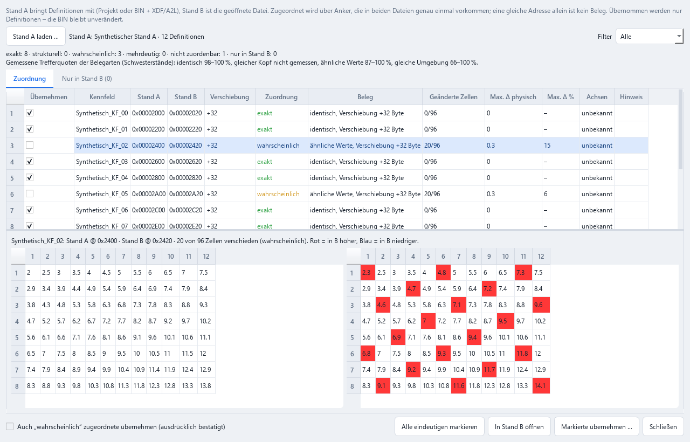

# Entwicklungsrunde 23.10.2026: Fehlfundanalyse, gemeinsame Achsen, Softwarestand-Abgleich, Projektbibliothek

Was in dieser Runde gemessen, gebaut und **verworfen** wurde. Alle Zahlen stammen aus Läufen der genannten Werkzeuge;
keine ist von Hand eingetragen.

## 1. Ausgangslage und Blocker

- Test-Suite auf `5a063ac`: **504 bestanden, 7 übersprungen**.
- Die Referenzpaare der bisherigen Benchmarks (EDC17CP09, EDC16C31/C35, MSD80/85, ME9, MED17.1.62 …) liegen **nicht im
  Repository und waren auf dem Entwicklungsrechner nicht vorhanden**. Eine Internetsuche nach rechtmäßig nutzbaren
  Ersatzpaaren bestätigte die Recherche vom 21.10. (siehe [ECU_SUPPORT.md](ECU_SUPPORT.md)): Es gibt keine.
  Unlizenzierte Uploads Dritter wurden nicht heruntergeladen.
- **Folge:** Für die Prioritätsfamilien konnte weder die Ausgangsmessung reproduziert noch eine Erkennungsänderung
  gegen Regressionen geprüft werden. Deshalb wurde **keine Änderung an der Kennfeldsuche übernommen**.
- Lokal messbar waren nur Siemens-C167-Paare (alle Rolle *training*, also **nicht unabhängig**):

| Paar | Referenz | Ref 2D | gefunden | exakt | Präzision | exakt 1D |
|---|---|---:|---:|---:|---:|---:|
| MS42 0110C6 | XDF v1.3 | 213 | 143 | 22 | 72 % | 398 |
| MS43 430069 E46 M54B30 | XDF 430069 512K | 367 | 312 | 196 | 79 % | 742 |
| MS43 430069 E39 M54B25 | ebenso | 367 | 316 | 188 | 78 % | 732 |

## 2. Fehlfundanalyse (Aufgabe 3.1)

Neues Werkzeug: `python -m ecu_studio.tools.miss_analysis MANIFEST.json [--limits]` (gleiches Manifest wie
`benchmark_suite`). Jedes verfehlte Referenzkennfeld (2D, ab 4×4) bekommt **ein** Ergebnis und beliebig viele
strukturelle Merkmale.

| Paar | Ref | verfehlt | kein Kandidat | falscher Start | falsche Größe | falsche Zellbreite | Achsen getrennt | gemeinsame Achse | gleiche Geometrie | flache Werte | Code-Verweis | Ergebnislimit |
|---|---:|---:|---:|---:|---:|---:|---:|---:|---:|---:|---:|---:|
| MS42 0110C6 | 213 | 191 | 72 | 98 | 21 | 0 | 191 | 132 | 169 | 7 | 0 | 0 |
| MS43 E46 | 367 | 171 | 73 | 81 | 13 | 4 | 171 | 101 | 150 | 15 | 30 | 0 |
| MS43 E39 | 367 | 179 | 70 | 90 | 13 | 6 | 179 | 112 | 160 | 32 | 36 | 0 |

Befunde:

- **Jedes** verfehlte Kennfeld hat seine Achsen getrennt gespeichert (kein Kopf direkt davor). 62–77 % teilen eine
  Achse mit einem anderen Kennfeld, 87–89 % liegen neben Kennfeldern gleicher Geometrie.
- **Ergebnislimit: 0.** Mit zehnfachen Grenzen wird kein einziges zusätzliches Kennfeld exakt gefunden; die Grenzen
  verdrängen also nichts.
- „Falscher Start“ ist meist ein Kandidat mit richtiger Spaltenzahl, aber um ±1–3 Zeilen verschobenem Start
  (Zeilenabstands- und C167-Code-Verweis-Kandidaten).
- In den Referenzen selbst teilen **150 von 213** (MS42) bzw. **261 von 367** (MS43) Kennfeldern eine gespeicherte Achse.
  Der Achsenpool wird bereits fast vollständig erkannt: 218 von 221 Referenzachsen (MS42) liegen im Ergebnis von
  `scan_count_axes`.

## 3. Geprüft und verworfen

| Ansatz | Messung | Entscheidung |
|---|---|---|
| **Lücken zwischen Kandidaten mit Achsenpool-Größen kacheln** (nur eindeutige, lückenlose Zerlegung) | MS42: 11 neue Kandidaten, 0 exakt · MS43 E46: 14, davon 2 exakt · MS43 E39: 21, davon 1 exakt | Verworfen: Präzision ≤ 14 %. Kandidatengrenzen sind zu unsicher, um eine Lücke zu schließen. |
| **Kettenverlängerung von exakten Funden** (Obergrenze vorab gemessen) | MS42: höchstens 57 statt 22 Kennfelder erreichbar, Auswahl der Zeilenzahl ohne eindeutiges Signal | Nicht gebaut: Ohne Bosch-/PowerPC-Referenzen nicht gegen Regressionen prüfbar. |
| **Start um ganze Zeilen schieben** | Kein Merkmal in den Daten entscheidet zuverlässig die richtige Zeile; Achsenpool liefert nur Größen, keine Lage | Verworfen. |
| **Direkte Verweise auf MS42-Gruppenkennfelder** (16-Bit-Offset, C16x-Seite) | 0 der geprüften Starts referenziert | Verworfen: MS42 adressiert indirekt; ein C167-Sonderdecoder widerspräche der Vorgabe „keine Familien-Sonderfälle“. |

**Grenze:** Ein messbarer Recall-Gewinn bei EDC17CP09/EDC16/MSD8x braucht deren Referenzen. Mit ihnen misst
`benchmark_suite --baseline` jede Änderung gegen den Vorstand, `miss_analysis` zeigt die Ursachen.

## 4. Gemeinsame Achsen (Aufgabe 3.2, 4.2)

Neu: `core/axis_groups.py`. Jedes Kennfeld kennt jetzt die **Dateiadresse seiner X-/Y-Stützstellen**
(`axis_x_offset`, `axis_y_offset`) und bei A2L-`COM_AXIS` den Namen des Achsobjekts (`axis_x_ref`). Gruppen entstehen
**nur über dieselbe Adresse**, nie über ähnliche Werte:

- *aus Definition*: alle Mitglieder aus A2L/XDF,
- *strukturell, ungeprüft*: mindestens ein Mitglied aus der Erkennung (Kopf-Datensatz, Code-Verweis),
- *unsicher*: Mitglieder widersprechen sich (Punktzahl, Achsname) oder die Achse liegt im Wertebereich eines Mitglieds.

Gleiche Achswerte an verschiedenen Adressen erscheinen getrennt als **Hypothese**.

Quellen der Adressen: A2L (`STD_AXIS` im Datensatz, `COM_AXIS` über `AXIS_PTS_REF`), XDF (eingebettete und verlinkte
Achsen), Kopf-Datensätze, Kennlinien-Datensätze und Code-Verweise der Erkennung. Projekte speichern die Felder; alte
Projekte laden unverändert. Bei der Namensübertragung wandert eine Achsadresse nur mit, wenn die Bytes am Ziel
übereinstimmen.

Validierung an der Definition (`benchmark_suite`, Spalten „Achsadresse richtig“ und „Gruppenpaare“; nur exakt
gefundene Kennfelder):

| Paar | Achsadresse richtig | Gruppenpaare gefunden / richtig / in Referenz |
|---|---:|---:|
| MS43 E46 | 346/350 | 491 / 491 / 572 |
| MS43 E39 | 341/345 | 503 / 503 / 564 |
| MS42 | – (keine erkannte Achsadresse) | 0 / 0 / 11 |

Keine falsche Gruppenbehauptung (Präzision 100 %), 86–89 % der Referenzpaare unter den exakt gefundenen Kennfeldern
werden erkannt. Datenrolle *training*: Das ist ein Funktionsnachweis, keine unabhängige Messung.

Sichtbar in der App: Katalogzeile „Achse geteilt“ (mit „(unsicher)“), Tooltip und Detailbereich mit Partnerkennfeldern,
*Kennfelder · Funktionsgruppen* (eigene Gruppen + CSV-Export), *Funktionsgraph* (gemeinsame Achse / Hypothese,
Doppelklick öffnet das Kennfeld).

## 5. Softwarestände vergleichen (Aufgaben 5.1–5.3, 8.3)

*Werkzeuge → Softwarestände vergleichen und Definitionen übernehmen …* (`core/version_compare.py`,
`ui/version_compare_dialog.py`). Ablauf: Stand A (Projekt oder BIN + XDF/A2L/CSV) laden → Zuordnung über eindeutige
Anker (`name_transfer`) → Klassen *exakt / strukturell / wahrscheinlich / mehrdeutig / nicht zuordenbar* → Differenzen
je Kennfeld (Zellen, max. Δ roh/physikalisch, %, Achsen, Formatkonflikt) → zwei synchronisierte Wertetabellen →
Markierte übernehmen (Vorschau aller Änderungen; nur Definitionen, BIN unverändert; „wahrscheinlich“ nur mit
ausdrücklicher Bestätigung; mehrdeutig nie; alles oder nichts) → Änderungsprotokoll im Projekt-Journal und
**Versionsstand mit den Definitionen** → Projekt speichern.

<picture>
  <source media="(prefers-color-scheme: dark)" srcset="images/dark-version-compare.png">
  
</picture>

Synthetische Daten, reproduzierbar mit `python -m ecu_studio.tools.screenshot --version-compare OUT_DIR`.

Messung an echten Schwesterkalibrierungen (MS43 430069 E46 → E39, 1454 XDF-Definitionen, 0,94 s): **jede**
zugeordnete Definition liegt am richtigen Ort – exakt 605/605, wahrscheinlich 530/530, mehrdeutig 5/5; 314 ohne Beleg.
Einschränkung: gleicher Softwarestand, also Verschiebung 0. Verschiebungen sind synthetisch getestet; die bestehende
Messung der Namensübertragung an MED17.1.62- und MSD80-Schwesterständen gilt weiter (`name_transfer.MEASURED`).

## 6. Projektbibliothek und Versionen (Aufgaben 6.1–6.3)

- Neue Metadaten: Familie, Hardware-/Softwarekennung (wörtlich aus der Datei), Definitionsquellen, App-Version,
  erstellt/geändert, geprüfte/ungeprüfte/geänderte Kennfelder, Anzahl Versionen. Sie stehen in zusätzlichen Tabellen;
  Tabelle `projects` und Schema-Version 1 bleiben unverändert, damit ältere Versionen dieselbe Datenbank weiter öffnen
  (ein Schema-Wechsel hätte 1.16 beim Start abbrechen lassen – im Test gefunden und vermieden).
- Eigene **Tags und Kommentare** (bleiben bei Neu-Indexierung erhalten), Filter nach Familie und Tag.
- Suche über 10 000 Einträge: unter 1 s im Test (kein BIN wird für die Liste geöffnet).
- Versions-Explorer: **zwei beliebige Stände vergleichen** (Bytes, betroffene Kennfelder, hinzugekommene/entfernte
  Definitionen). Versionsstände können ihre Definitionen mitspeichern (`make_snapshot(..., maps=...)`).

## 7. Benchmark-Erweiterungen (Aufgaben 9.1, 9.3, 9.4)

`benchmark_suite` schreibt jetzt Version, Commit, Quelle und Lizenzangabe der Referenz, Achsadress- und
Gruppenpaar-Kennzahlen. Mit `--baseline ALT.json` entsteht ein Vorher/Nachher-Vergleich je Paar. Bewertung:
*verbessert* nur bei mehr exakten Kennfeldern **und** höchstens 1 Prozentpunkt weniger Präzision. Mehr Kandidaten
allein heißt *nur mehr Kandidaten*, nie Verbesserung. Diese Runde: alle drei lokalen Paare *unverändert*,
Laufzeit innerhalb der Messstreuung (je zwei Läufe alt/neu).

## 8. Qualitätsmatrix

Die Gewichte sind eine strategische Priorisierung, keine Messung der Gleichwertigkeit mit kommerziellen Werkzeugen.
„Erfüllt“ heißt: Kriterium ist durch einen Test oder eine Messung belegt.

| Bereich (Gewicht) | Überprüfbares Kriterium | Stand 23.10.2026 | Nachweis |
|---|---|---|---|
| Erkennung (30 %) | Exakte Kennfelder je Familie mit vollständiger Referenz | wie 1.16.0, in dieser Runde unverändert | `benchmark_suite --baseline` (lokal 3 Paare) |
| | Präzision auf unabhängigen Testpaaren | MSD80/85, EDC16C35/C31, MED9 laut ECU_SUPPORT; nicht neu gemessen (Daten fehlen) | ECU_SUPPORT.md |
| | Ursachen der Fehlfunde je Paar | erfüllt (neu) | `miss_analysis` |
| | Gemeinsame Achsen ohne Fehlbehauptung | erfüllt an MS43 (491/491, Rolle training) | Abschnitt 4 |
| Editor (20 %) | Undo/Redo, Mehrfachauswahl, Formeln, Glättung | in dieser Runde nicht bewertet | – |
| | Gleichzeitige Ansichten zweier Stände synchron | erfüllt (neu, Vergleichsdialog) | `test_version_compare.py` |
| Projekte (15 %) | Atomare Speicherung, Integritäts-Hash, Original geschützt | vorhanden | `test_next_core.py`, `test_core.py` |
| | Bibliothek mit Metadaten, Tags, Filtern, ≥ 1000 Einträge flüssig | erfüllt (neu, 10 000 < 1 s) | `test_project_library.py` |
| | Zwei beliebige Versionen vergleichen | erfüllt (neu) | `test_version_compare.py` |
| ECU-Abdeckung (15 %) | Familien validiert mit vollständiger Referenz | 9 (laut ECU_SUPPORT), unverändert | ECU_SUPPORT.md |
| Interoperabilität (10 %) | A2L COM_AXIS / XDF verlinkte Achsen mit Achsadresse | erfüllt (neu) | `test_axis_groups.py` |
| | Offenes Kennfeldpaket-Format | offen | – |
| Qualitätssicherung (10 %) | Vorher/Nachher-Bericht mit Regressionsurteil | erfüllt (neu) | `test_benchmark_suite.py` |
| | Testlauf | 531 bestanden, 7 übersprungen | pytest |

## 9. Nächste Schritte

1. **Referenzpaare bereitstellen** (EDC17CP09, EDC16, MSD80/85 lokal, Manifest wie in `examples/templates`), dann
   `miss_analysis` und `benchmark_suite --baseline` laufen lassen. Erst damit lässt sich ein Gruppenkennfeld-Detektor
   für Bosch (headerlose Werteblöcke mit Achsen aus dem Pool) bauen und messen.
2. **Offenes Kennfeldpaket** (Aufgabe 8.2) auf Basis der jetzt vorhandenen Achsadressen und Gruppen.
3. ~~Kontrollierte Werteübernahme~~ – erledigt (Nachtrag unten).

## Nachtrag: Werteübernahme und Kompatibilität

- **Werteänderungen von Stand A übertragen** (Vergleichsdialog): Die markierten, eindeutigen Zuordnungen gehen als
  explizite Paarung an den bestehenden geprüften Transfer (`smart_transfer`). Dessen Regeln gelten unverändert:
  hashgebundene, fachlich bestätigte Identität und gleiche Hardware, bestätigte Definitionen auf beiden Seiten,
  gleiche Einheiten und Achsen, Überlaufprüfung, Vorschau je Zelle, ausdrückliche Bestätigung, ein Undo-Schritt,
  Original unverändert, Eintrag im Journal. Übertragen werden nur ORI→MOD-Änderungen eines Projekts.
- **Korrektur:** Der Abgleich ordnete über die bearbeiteten Bytes zu. Ein MOD-Projekt als Stand A machte damit aus
  „exakt“ ein „wahrscheinlich“. Zuordnung und Differenzen nutzen jetzt die Originale beider Stände. Die
  MS43-Messung oben ist unverändert (1140/1140), die Laufzeit sinkt von 0,94 auf 0,31 s.
- **Achsen:** Stuft der Abgleich die Achsen in Stand B als „abweichend/ungeprüft“ ein, übernimmt eine Definition
  keine Achswerte aus Stand A. Der Transfer blockiert dort, statt ungelesene Achsen als gleich zu behandeln.
- **Projekte neuerer Versionen** öffnen mit Warnung statt Abbruch (Felder werden genannt, bleiben beim Speichern
  aber verlustfrei erhalten und werden in dieser Version nicht angezeigt); Kommandozeilen-Werkzeuge bleiben strikt.
- **Werteübernahme:** Eine unabhängige synthetische Layout-Matrix prüft mehrere Softwarestand-Formate (u8/u16/s16,
  Byte-Reihenfolge, Skalierung, Offsets), Übernahmeergebnis und Undo. Echte OEM-Softwarestände fehlen weiterhin und
  werden durch diese Tests nicht ersetzt.
