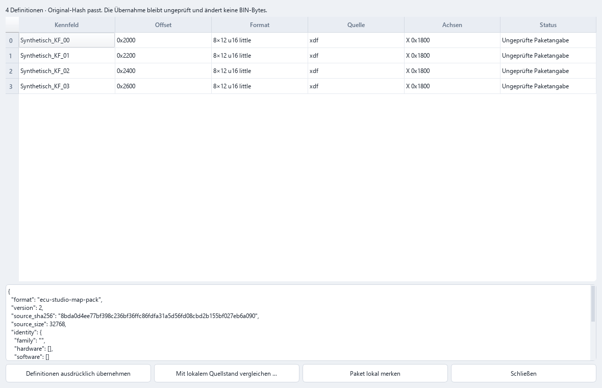

# Entwicklungsprüfung für 1.17.0, 24.10.2026

Ausgangspunkt ist `main` bei `76b1a93` (1.16.4). Der Entwicklungskandidat liegt im
[Entwurfs-PR #6](https://github.com/PCTestAdmin/ECU-Studio-AI/pull/6), Branch
`feature/open-map-pack-117`. Er wurde weder zusammengeführt noch als Release veröffentlicht.
Versionsnummer und Update-Kanal bleiben unverändert. Lokal gebaute Dateien mit der Bezeichnung
1.16.4 sind unveröffentlichte Entwicklungsartefakte, kein Ersatz für das bestehende Release.

## Technische Bewertung

| Bereich | Vorher | Nachher | Nachweis | Status |
|---|---|---|---|---|
| EDC17CP09-Kennfelderkennung | Dokumentiert: 463/703 exakt, 85 % Präzision | **nicht gemessen – Referenzdaten fehlen** | [Bestehende Referenzstände](ECU_SUPPORT.md); lokaler Datenbestand geprüft | Unverändert, Ziel 500/703 nicht nachgewiesen |
| EDC16C31/C35-Kennfelderkennung | Dokumentiert: C31 272/364, 82 %; C35 283/387, 81 % | **nicht gemessen – Referenzdaten fehlen** | [Bestehende Referenzstände](ECU_SUPPORT.md) | Unverändert, Ziele 290/364 und 300/387 nicht nachgewiesen |
| Gruppenkennfelder | Gruppierung bekannter Definitionen über gespeicherte Achsadressen | Gruppen im Paket erhalten; kombinierte Fehlfundanalyse. Neuer Detektor: **nicht gemessen – Referenzdaten fehlen** | Pakettests; MS42-Kontrolllauf und Fehlfundanalyse unten | Messworkflow umgesetzt, Scanner unverändert |
| Kennfeldpakete | Einfaches JSON v1; Hashabweichung konnte zugelassen werden | v2, Identitätsprüfung, Vorschau, Konfliktsperren, Herkunft, Ressourcenlimits und gemeinsame Rücknahme | `test_map_pack.py`, `test_map_pack_workflow.py`, GUI-Smoke | Implementiert; v1 bleibt lesbar |
| Softwarestand-Vergleich | Vorhandener Abgleich und kontrollierte Übernahme | Paket mit anderer Original-BIN führt nach Prüfung der lokalen Quell-BIN in denselben Abgleich | Synthetischer Integrationstest einschließlich vollständigem Quellhash im GUI-Pfad | Mechanik geprüft; keine neue reale Kompatibilitätsfreigabe |
| Projektverwaltung | Bibliothek, Versionen, Journal, verlustfreie unbekannte Projektfelder | Lokaler Paketindex, nachvollziehbare Vorschläge, Pakettransaktion mit Versionsstand und Undo/Redo | Speichern/Öffnen, Originalintegrität, Abbruch, Katalogkonflikte und Undo-Reihenfolge geprüft | Implementiert |
| Leistung | MS42-Kontrolle: 2,34 s | 2,33 s; Paketablauf mit 5000 Definitionen: Median 3,869 s | Lokaler Kontrolllauf; drei Paketmessungen je Größe | Kein belegter Geschwindigkeitsgewinn |
| Stabilität | 542 bestanden, 7 übersprungen | 591 bestanden, 7 übersprungen, 0 fehlgeschlagen | Vollständige lokale Suite; Windows-CI Python 3.11/3.12; Windows-Paketprüfung | Tests und Build geprüft; OEM-Abnahme offen |

Die historischen Zahlen sind mit `ECU_SUPPORT.md`, `PROGRESS.md` und dem Bericht vom 23.10.
abgeglichen. Sie sind hier **keine neuen Messungen**. Auch für MSD85 (279/1026, 81 %) und MSD80
(217–224/864, 81–82 %) gilt: **nicht gemessen – Referenzdaten fehlen**.

## Tatsächlich gemessene Kontrolle

Die lokal vorhandene öffentliche MS42-Referenz für 0110C6 wurde mit dem unveränderten Scanner gemessen.
Dieses Paar war bereits für frühere Entwicklung verwendet worden und bleibt ausdrücklich `training`.
Unabhängige reale Testpaare: **0**. Keine OEM-Validierung.

| Metrik | 1.16.4, `76b1a93` | Kandidat, `90f266d` |
|---|---:|---:|
| Referenzkennfelder 2D | 213 | 213 |
| Exakte Layouts 2D | 22 | 22 |
| 2D-Kandidaten | 143 | 143 |
| Recall nach bestehendem Überlappungskriterium | 49,8 % | 49,8 % |
| Präzision nach bestehendem Überlappungskriterium | 72,0 % | 72,0 % |
| Falsche Kandidaten nach diesem Kriterium | 40 | 40 |
| Nicht abgedeckte Referenzen nach diesem Kriterium | 107 | 107 |
| Exakte Kennlinien 1D | 398 | 398 |
| Scannerlaufzeit | 2,34 s | 2,33 s |
| Python-Allokationspeak, separater Lauf | nicht erhoben | 14,0 MiB |

Die 2D-Messung umfasst wie bisher Referenztabellen mit mindestens 4 × 4 Zellen; Kennlinien werden separat bewertet.
Recall und Präzision verwenden das bestehende IoU-Kriterium (mindestens 0,5 Überdeckung),
**nicht** die strengere exakte Layoutübereinstimmung. Laufzeiten sind einzelne lokale Kontrollmessungen
und schwanken unter Hintergrundlast; daraus lässt sich kein belastbarer Performancegewinn ableiten.
Der Speicherwert ist `tracemalloc`, kein Prozess-RSS. Der frühere Kandidatenlauf bei `bc691ec`
ergab dieselben Trefferzahlen und 2,25 s. Es gibt keine Scanneränderung zwischen diesen Ständen.

Die Baseline wurde aus einem separaten Checkout des unveränderten Tags erneut erzeugt; das rohe Ergebnis
bleibt lokal erhalten. Für den neuen Vergleich wurden ausschließlich Eingabebindungen (Referenzhash,
Softwarestand und Datenart) ergänzt, keine Messwerte geändert. Die alte Baseline enthält keine einzelnen
exakten Layoutschlüssel; neue/verlorene Einzeltreffer sind deshalb aus diesem Altvergleich nicht ableitbar.
Neue Läufe erfassen die Schlüssel für zukünftige Vergleiche.

191 von 213 Referenzlayouts sind nicht exakt erkannt: 72 ohne Kandidat, 98 mit falschem Start,
21 mit falscher Geometrie. Die Merkmale überlappen: alle 191 haben getrennte Achsen, 132 eine gemeinsame
Achse, 169 wiederkehrende Geometrie und 7 flache Werte. Diese Merkmale sind Hinweise, kein kausaler
Nachweis eines Bosch-Detektors. Dafür fehlen die passenden Bosch-Daten.

Die [öffentliche Zusammenfassung](validation/117-control-summary.json) enthält Hashbindungen,
Quellcode-Digest, aggregierte Messungen und Paketlaufzeiten. Originale, Definitionen, lokale Manifeste,
vollständige Fehlfundlisten und private Dateipfade bleiben außerhalb von Git und Actions-Artefakten.

## Implementierung und praktische Wirkung

Das vorhandene `ecu-studio-map-pack` wird erweitert. Kein zweites Paketformat, kein neuer Scanner,
keine zusätzlichen Abhängigkeiten. Details stehen im [offenen Format](MAP_PACK.md).

Direkter Import erfordert Original-SHA-256 und Dateigröße sowie passende erklärte ECU-/HW-/SW-Kennungen.
Die Vorschau zeigt Definitionen, Achsadressen, Quelle, Autorenstatus und Konflikte. Überlappungen oder
unbekannte zukünftige Felder sperren die gesamte Übernahme. Es werden keine vorhandenen Definitionen
überschrieben. Eine explizite Bestätigung legt Definitionen, Versionsstand und Journal atomar an;
Strg+Z/Strg+Y nutzen den bestehenden chronologischen Undo-Stapel. Firmwarebytes bleiben unverändert.

Jede importierte Definition startet ungeprüft. Der vom Autor behauptete Prüfstatus und der Quellhash
bleiben als Herkunft sichtbar. Bei anderem Original wird die zum Paket passende lokale Quell-BIN
hashgeprüft und der bestehende `version_compare` verwendet. Gleiche Offsets reichen nicht aus.
`smart_transfer`, Prüfsummensperren und Flashfreigabe werden nicht erweitert oder abgeschwächt.

Der Export bietet alle, bestätigte oder ausgewählte Definitionen sowie optionale Achsadressen/Gruppen.
Freie Notizen sind standardmäßig ausgeschlossen; Beschreibungen/Belege können ausdrücklich eingeschlossen
werden. Der bestehende Projektindex erhält eine additive Cache-Tabelle. Bekannte Pakete und Projekte
werden bei gleichem Hash oder gleicher erkannter Familie angeboten, niemals automatisch übernommen.

Der [Messworkflow](REFERENCE_VALIDATION.md) verbindet `benchmark_suite` und `miss_analysis` über ein
lokales Manifest mit BIN-/Referenzhash, Softwarestand, Datenrolle, Herkunft und deklarierter Vollständigkeit.
Hashänderungen, Rollenvermischung und nahezu identische Firmware in verschiedenen Rollen werden abgewiesen.
Reale Referenzen sind im neuen CI-Messworkflow gesperrt; synthetische Paare zählen nie als unabhängiger
realer Nachweis. Ein Manifest beweist weder Lizenzrechte noch fachliche Unabhängigkeit automatisch.

## Prüfungen und Laufzeiten

Die vollständige Suite wurde vor und nach den Änderungen ausgeführt. Im Endstand gibt es keine
fehlgeschlagenen Tests. Die sieben übersprungenen Tests benötigen ausdrücklich konfigurierte lokale
Referenzdateien. Zwei zwischenzeitliche Übersetzungsfehler wurden durch Ergänzung des englischen
Katalogs behoben. Deutsch/Englisch: 1920 erfasste Texte, keine fehlende englische Übersetzung.

Neue Prüfungen decken sieben Datentypen in beiden Byte-Reihenfolgen, gemeinsame Achsen, Hash-/ECU-/HW-/SW-
Konflikte, Adress-/Geometriefehler, beschädigtes JSON, unbekannte Felder, Ressourcenlimits, doppelte und
überlappende Definitionen, unverifizierte Übernahme, Abbruch, veraltete Vorschau und Undo/Redo ab.
Der Integrationstest verbindet Scan, GUI-Import, anderen Softwarestand, Übernahme, Projektversionsstand,
Speichern/Öffnen und Integritätsprüfung ohne private Dateien.

`build_release.ps1` prüft unter Windows mit den gesperrten Python-3.13-x64-Abhängigkeiten die Tests,
Quell-GUI, portable EXE und Selbsttests. Das erzeugte ZIP wird entpackt und die EXE ohne Python im PATH
erneut geprüft. EXE, ZIP, SHA-256 und Inno-Installer wurden lokal erfolgreich erzeugt. Das ist ein Build-
und synthetischer GUI-Nachweis, **kein** installierter OEM-/Fahrzeugtest und keine neue Update-Migrationsabnahme.
Die neun GUI-Smoke-Gruppen einschließlich Paketvorschau, Import, Undo/Redo und Vorschlägen bestehen.

Paketlaufzeiten auf diesem Entwicklungsrechner, je drei Wiederholungen; gemessen werden Erstellen,
Export, Lesen, Vorschau, Übernahme und Undo/Redo zusammen:

| Definitionen | JSON-Größe in Bytes | Median in Sekunden |
|---|---:|---:|
| 100 | 101715 | 0,096 |
| 1000 | 1014534 | 0,717 |
| 5000 | 5078534 | 3,869 |

Die Oberfläche verwendet den vorhandenen Hintergrunddialog für das Lesen sowie ein virtuelles Tabellenmodell.
Sehr große Vorschauen und Katalogtransaktionen laufen anschließend auf dem GUI-Thread und können kurz
blockieren; die obigen Zeiten sind keine garantierten Interaktionszeiten auf anderen Rechnern.

## Bewusst verworfene Ansätze und Grenzen

- Kein Gruppenkennfeld- oder zusätzlicher CPU-Detektor ohne passende Referenzmessung. Die vorhandenen
  TriCore-/PowerPC-Verweise wurden geprüft und werden weiterverwendet; ein neuer Decoder allein belegt
  keinen Erkennungsgewinn.
- Keine Übernahme an identische Offsets bei anderem Hash. Die alte Option `allow_mismatch` umgeht die
  Identitätsprüfung nicht mehr. Das ist eine bewusste Einschränkung unsicherer Altimporte.
- Keine automatische Verifikation aus Autorenangaben und kein manipulationssicherer OEM-Nachweis durch JSON.
- Keine vollständigen Firmwareabbilder oder privaten Referenzdateien im Paket, PR oder CI.
- Keine parallele Paketbibliothek: der vorhandene Projektindex wird erweitert. Keine generelle Neuentwicklung
  von Navigation, Hex-/Tabellen-/3D-Synchronisierung, Versionierung oder Projektformat.
- Achsen haben im bestehenden Datenmodell keinen separaten Speicherdatentyp. Adressen und minimale
  Bereichslängen werden geprüft; eine unabhängige Verifikation aller Achsbytes wird nicht behauptet.
- Überlappungen werden konservativ anhand der Bytehüllen erkannt. Manche fachlich zulässigen überlagerten
  Definitionen benötigen daher eine manuelle Entscheidung außerhalb dieses direkten Imports.
- Unbekannte Paketfelder bleiben beim Lesen/Schreiben erhalten, sperren aber den Import. Unbekannte
  Projektfelder bleiben verlustfrei erhalten und werden nicht mit unbekannter Bedeutung exportiert.
- Undo ist sitzungsbezogen. Nicht transaktionale spätere Definitionsänderungen können eine veraltete
  Rücknahme sperren; Journal und gespeicherte Versionsstände bleiben erhalten.
- Metadaten und Namen vor Weitergabe fachlich auf private Informationen prüfen. Ein Schema kann die
  Bedeutung frei gewählter Bezeichnungen nicht automatisch erkennen.
- Reale Übertragbarkeit unterschiedlicher Softwarestände und OEM-Prüfsummenkorrektur sind weiterhin nicht
  neu nachgewiesen. Keine solche Unterstützung wird durch diesen Kandidaten freigeschaltet.

## Konkreter Referenzbedarf und nächste Schritte

1. Nutzbare vollständige Original-/Definitionspaare für EDC17CP09 `6P8KB574`, EDC16C35 `4M702389`,
   EDC16C31 `6m661411`, MSD85 `791I200S` und MSD80 `37IIAFAA` bis `37IIANAA` lokal bereitstellen:
   SHA-256 beider Dateien, Software-/Hardwarekennung, Speichersegmente/EPK, Rechte-/Quellnachweis und
   Vollständigkeit. Für Transfermessungen mindestens zwei unterschiedliche Softwarestände. Die vorhandene
   EDC17C69-Original-BIN ohne passende vollständige Definition ersetzt diese Referenzpaare nicht.
2. Hashgebundene Fehlfundmessung mit getrennten Entwicklungs- und unabhängigen Testgruppen ausführen.
   Erst dann den häufigsten strukturellen Fehler gezielt im vorhandenen Scanner verbessern; exakte Gewinne,
   Verluste, Präzision, Kandidatenzahl und Laufzeiten je Familie kontrollieren.
3. Den Paketablauf an diesen realen Softwareständen fachlich abnehmen, insbesondere Achsspeicherung und
   Zuordnungsmehrdeutigkeiten. Danach PR prüfen und über die ausdrücklich freizugebende Version 1.17.0
   entscheiden; keine automatische Veröffentlichung.

## Commits und geänderte Dateien

| Commit | Inhalt |
|---|---|
| `06ccb84` | Hashgebundene Referenzmessung und Fehlfundanalyse |
| `376bb17` | Offenes Kennfeldpaket v2, Validator, atomare Katalogübernahme |
| `ac4262b` | Projektindex, Vorschläge, GUI, Softwarestand-Vergleich und Integration |
| `bc691ec` | Rollenbrücken und wechselnde Messeingaben abweisen |
| `90f266d` | Vollständiger Quellhash im Vergleich und Prüfung des GUI-Pfads |

Geänderte Komponenten gegenüber `main`:

- Kern: `core/map_pack.py`, `core/reference_manifest.py`, `core/model.py`, `core/project_store.py`, `core/workflows.py`.
- Messung/Werkzeuge: `tools/benchmark_suite.py`, `tools/validation_report.py`, `tools/gui_smoke.py`, `tools/screenshot.py`.
- Oberfläche: `ui/map_pack_dialog.py`, `ui/main_window.py`, `recognition/data/i18n/en.json`.
- Tests: `tests/test_map_pack.py`, `tests/test_map_pack_workflow.py`, `tests/test_reference_manifest.py`,
  `tests/test_a2l_and_workflows.py`.
- Dokumentation: `README.md`, `ROADMAP.md`, `CHANGELOG.md`, `docs/README.md`, `docs/MAP_PACK.md`,
  `docs/REFERENCE_VALIDATION.md`, dieser Bericht, `docs/validation/117-control-summary.json`,
  `docs/images/light-map-pack.png`, `docs/images/dark-map-pack.png`.

Die Kern-/Werkzeug-/Oberflächenpfade beziehen sich auf `src/ecu_studio/`. Der abschließende
Dokumentationscommit ist im PR sichtbar. Die vollständige Dateiliste und alle Diff-Zeilen stehen im
[PR-Diff](https://github.com/PCTestAdmin/ECU-Studio-AI/pull/6/files).
