# 📈 Fortschritt der Kennfelderkennung

Wie sich die automatische Erkennung **ohne Definition** von Version zu Version entwickelt hat – gemessen, nicht
geschätzt. Für jeden Meilenstein wurde der **damalige Erkennungscode** aus der Git-Historie ausgecheckt und gegen
**dieselben Referenzen mit derselben heutigen Messmethode** bewertet. So sind alle Spalten direkt vergleichbar.

> **Exakt** = Fund mit gleichem Start, gleicher Größe und gleicher Zellbreite wie das Referenzkennfeld (2D, ab 4×4).
> **Gefunden** = Anteil der Referenzkennfelder, die ein Fund zu mindestens 50 % überdeckt.
> **Präzision** = Anteil der Funde, die auf ein echtes Kennfeld fallen – nur bei vollständiger Referenz angegeben.
> **Test** = Daten, die nie zum Einstellen der Erkennung verwendet wurden.

## Meilensteine

| Kürzel | Stand | Was neu war |
|---|---|---|
| **M0** | 1.14 | Raster-Erkennung (Stand vor dem Umbau) |
| **M1** | 18./19.10. | Neue Strukturerkennung: Zeilenabstand, Achsen-Arrays, C16x-Code-Verweise |
| **M2** | 19.10. | Lernmodell für Datenmuster, Konfidenz je Familie, ME7-Lookup-Aufrufe |
| **M3** | 19.10. | ME7.5-Speicherbasis und Kennfeldköpfe, 68k-Verweise (GM), schnellere Suche |
| **M4** | 19.10. | Denso/SH-2-Beschreibungsblöcke (Subaru) |
| **M5** | 20.10. | Mehr Kopf-Datensätze (55 → 200), A2L-Referenzen |
| **M6** | **1.15.0** | Kopf-Datensätze mit Vorzeichen, bis 1000, Achsen als Kandidaten |
| **M7** | **nächste Version** | Kopf-Datensätze auch mit flachen Werten, Datensatz-Ketten, Vorrang und kein Limit für belegte Funde |

## Auf einen Blick: exakt erkannte Kennfelder, 1.14 → 1.15.0 → nächste Version

```mermaid
xychart-beta
    title "Exakt erkannte Kennfelder (vollständige Referenzen)"
    x-axis ["EDC17CP09", "MSD85", "MSD80", "EDC16C31", "ME9.2.1", "MS43"]
    y-axis "Kennfelder" 0 --> 500
    bar [463, 279, 217, 272, 170, 197]
    bar [157, 148, 133, 123, 109, 197]
    bar [12, 26, 23, 36, 9, 1]
```

Überlagerte Balken, von hinten nach vorn: nächste Version · 1.15.0 · 1.14 (alte Raster-Erkennung).

| Steuergerät | 1.14 | 1.15.0 | nächste Version | Faktor zu 1.14 |
|---|---:|---:|---:|---:|
| Bosch EDC17CP09 | 12 | 157 | **463** | ×39 |
| Siemens MSD85 · *Test* | 26 | 148 | **279** | ×11 |
| Siemens MSD80 · *Test* | 23 | 133 | **217** | ×9 |
| Bosch EDC16C31 | 36 | 123 | **272** | ×8 |
| BMW ME9.2.1 | 9 | 109 | **170** | ×19 |
| Siemens MS43 | 1 | 197 | **197** | ×197 |

## Vollständige Hersteller-Referenz (A2L) – Präzision belastbar

**Exakt erkannte Kennfelder je Meilenstein** (Referenzkennfelder in Klammern)

| Steuergerät | M0 | M1 | M2 | M3 | M4 | M5 | M6 | M7 |
|---|---:|---:|---:|---:|---:|---:|---:|---:|
| Bosch EDC17CP09 (703) | 12 | 37 | 35 | 35 | 35 | 46 | 157 | **463** |
| Siemens MSD85 · *Test* (1026) | 26 | 45 | 46 | 46 | 46 | 91 | 148 | **279** |
| Siemens MSD80 · *Test* (864) | 23 | 53 | 51 | 51 | 51 | 93 | 133 | **217** |
| Bosch EDC16C35 (387) | 30 | 48 | 48 | 48 | 48 | 91 | 111 | **283** |
| Bosch EDC16C31 (364) | 36 | 51 | 51 | 51 | 51 | 93 | 123 | **272** |
| BMW ME9 (233) | 14 | 20 | 20 | 20 | 20 | 38 | 41 | **98** |
| BMW ME9.2.1 (460) | 9 | 29 | 29 | 29 | 29 | 56 | 109 | **170** |
| Siemens MS45 (472) | 0 | 21 | 21 | 21 | 21 | 28 | 28 | **30** |

Trefferquote und Präzision je Meilenstein

 

| Steuergerät | M0 | M1 | M2 | M3 | M4 | M5 | M6 | M7 |
|---|---:|---:|---:|---:|---:|---:|---:|---:|
| Bosch EDC17CP09 | 5% · 77% | 23% · 52% | 20% · 61% | 20% · 61% | 20% · 61% | 21% · 62% | 30% · 71% | 71% · 85% |
| Siemens MSD85 · *Test* | 4% · 93% | 18% · 57% | 16% · 69% | 16% · 69% | 16% · 69% | 18% · 72% | 24% · 74% | 36% · 81% |
| Siemens MSD80 · *Test* | 4% · 84% | 24% · 62% | 22% · 72% | 22% · 72% | 22% · 72% | 24% · 73% | 29% · 77% | 38% · 82% |
| Bosch EDC16C35 | 10% · 78% | 34% · 43% | 29% · 58% | 29% · 58% | 29% · 58% | 35% · 64% | 40% · 66% | 80% · 81% |
| Bosch EDC16C31 | 14% · 86% | 42% · 49% | 37% · 65% | 37% · 65% | 37% · 65% | 42% · 69% | 48% · 71% | 84% · 82% |
| BMW ME9 | 9% · 96% | 34% · 27% | 30% · 44% | 30% · 44% | 30% · 44% | 35% · 50% | 36% · 50% | 56% · 62% |
| BMW ME9.2.1 | 5% · 64% | 41% · 53% | 36% · 62% | 36% · 62% | 36% · 62% | 38% · 63% | 44% · 69% | 54% · 72% |
| Siemens MS45 | 1% · 60% | 19% · 39% | 16% · 64% | 16% · 64% | 16% · 64% | 18% · 67% | 18% · 67% | 18% · 66% |

Format: gefunden · Präzision.

## Vollständige Community-Referenz (XDF)

**Exakt erkannte Kennfelder je Meilenstein** (Referenzkennfelder in Klammern)

| Steuergerät | M0 | M1 | M2 | M3 | M4 | M5 | M6 | M7 |
|---|---:|---:|---:|---:|---:|---:|---:|---:|
| Siemens MS43 (379) | 1 | 197 | 197 | 197 | 197 | 197 | 197 | **197** |
| Siemens MS42 (213) | 5 | 22 | 22 | 22 | 22 | 22 | 22 | **22** |

Trefferquote und Präzision je Meilenstein

 

| Steuergerät | M0 | M1 | M2 | M3 | M4 | M5 | M6 | M7 |
|---|---:|---:|---:|---:|---:|---:|---:|---:|
| Siemens MS43 | 4% · 71% | 67% · 76% | 66% · 80% | 66% · 80% | 66% · 80% | 66% · 80% | 66% · 80% | 66% · 79% |
| Siemens MS42 | 13% · 72% | 55% · 67% | 50% · 72% | 50% · 72% | 50% · 72% | 50% · 72% | 50% · 72% | 50% · 72% |

Format: gefunden · Präzision.

## Teil-Referenz – nur Trefferquote und exakte Funde aussagekräftig

**Exakt erkannte Kennfelder je Meilenstein** (Referenzkennfelder in Klammern)

| Steuergerät | M0 | M1 | M2 | M3 | M4 | M5 | M6 | M7 |
|---|---:|---:|---:|---:|---:|---:|---:|---:|
| Bosch ME7.5 (VAG 06A906032HS) (266) | 1 | 16 | 16 | 50 | 50 | 59 | 68 | **85** |
| Bosch ME7.5 (VAG 8E0909518AK) (129) | 4 | 19 | 16 | 37 | 37 | 37 | 38 | **43** |
| Bosch ME7 (Volvo 40LNHJ) (48) | 0 | 6 | 5 | 6 | 6 | 6 | 6 | **11** |
| Bosch ME7 (Volvo 50GMHJ) (38) | 0 | 6 | 6 | 6 | 6 | 7 | 7 | **7** |
| GM P01 (68k) (43) | 0 | 1 | 1 | 10 | 10 | 10 | 10 | **10** |
| Bosch M4.4 (Volvo, 8051) (28) | 0 | 8 | 8 | 8 | 8 | 8 | 8 | **8** |
| Bosch MED17.1.62 (404A) (1337) | 7 | 25 | 30 | 30 | 30 | 39 | 52 | **134** |
| Bosch MED17.1.62 (404L) (1137) | 4 | 35 | 40 | 40 | 40 | 40 | 49 | **121** |
| Bosch MED9 · *Test* (43) | 3 | 7 | 7 | 7 | 7 | 9 | 9 | **11** |
| Denso SH-2 (Subaru 5EAT) (147) | 0 | 21 | 22 | 22 | 147 | 147 | 147 | **147** |

Trefferquote je Meilenstein

 

| Steuergerät | M0 | M1 | M2 | M3 | M4 | M5 | M6 | M7 |
|---|---:|---:|---:|---:|---:|---:|---:|---:|
| Bosch ME7.5 (VAG 06A906032HS) | 0% | 41% | 36% | 46% | 46% | 46% | 48% | 53% |
| Bosch ME7.5 (VAG 8E0909518AK) | 5% | 44% | 43% | 57% | 57% | 57% | 58% | 60% |
| Bosch ME7 (Volvo 40LNHJ) | 6% | 54% | 52% | 54% | 54% | 56% | 56% | 65% |
| Bosch ME7 (Volvo 50GMHJ) | 10% | 58% | 58% | 55% | 55% | 55% | 55% | 55% |
| GM P01 (68k) | 5% | 28% | 21% | 35% | 35% | 35% | 35% | 35% |
| Bosch M4.4 (Volvo, 8051) | 4% | 57% | 54% | 54% | 54% | 54% | 54% | 54% |
| Bosch MED17.1.62 (404A) | 3% | 10% | 10% | 10% | 10% | 11% | 13% | 24% |
| Bosch MED17.1.62 (404L) | 3% | 14% | 14% | 14% | 14% | 16% | 18% | 28% |
| Bosch MED9 · *Test* | 12% | 49% | 49% | 49% | 49% | 51% | 51% | 56% |
| Denso SH-2 (Subaru 5EAT) | 0% | 54% | 48% | 48% | 100% | 100% | 100% | 100% |

Gefunden. Präzision nicht angegeben: Die Referenz enthält nur einen Teil der Kennfelder.

## Kennlinien und Achsen (1D, exakt)

| Steuergerät | M0 | M6 (1.15.0) | M7 (nächste Version) |
|---|---:|---:|---:|
| Bosch EDC17CP09 | 0 | 332 | **946** |
| Siemens MSD85 · *Test* | 0 | 354 | **642** |
| Bosch EDC16C31 | 0 | 242 | **544** |
| BMW ME9.2.1 | 0 | 263 | **385** |
| Siemens MS43 | 0 | 743 | **743** |
| Bosch ME7.5 (VAG 06A906032HS) | 0 | 134 | **134** |

## Laufzeit je Datei (Sekunden, gleicher Rechner)

| Steuergerät | M0 | M1 | M6 (1.15.0) | M7 (nächste Version) |
|---|---:|---:|---:|---:|
| Siemens MS43 | 1.4 | 14.18 | 4.98 | 3.82 |
| Bosch EDC17CP09 | 16.35 | 101.53 | 43.02 | 31.75 |
| Siemens MSD85 · *Test* | 4.39 | 44.22 | 14.86 | 10.91 |
| Bosch ME7.5 (VAG 06A906032HS) | 7.3 | 26.63 | 13.32 | 10.07 |
| Bosch MED17.1.62 (404A) | 11.38 | 92.98 | 30.22 | 24.22 |

## Grenzen dieser Messung

- **Teil-Referenzen** (Community-XDFs, RomRaider-Auswahl) enthalten nicht alle Kennfelder; dort zählt die Zahl exakter
  Funde, nicht die Präzision.
- Die meisten Paare wurden während der Entwicklung zum Einstellen genutzt (*development*). Unabhängige *Test*-Daten
  sind MSD80, MSD85 und MED9 (EDC16C31/C35 wurden in früheren Runden zum Einstellen genutzt, in Runde M7 nicht) – ihre Verbesserung ist der ehrlichste Hinweis auf die Wirkung bei neuen Steuergeräten.
- Neue Steuergeräte-Familien ohne Referenzdaten (z. B. MG1, MD1, Simos) sind hier nicht enthalten, siehe
  [ECU_SUPPORT.md](ECU_SUPPORT.md).
- Reproduzieren: `python -m ecu_studio.tools.benchmark_suite MANIFEST.json` mit eigenen, rechtmäßig verfügbaren Paaren
  (Vorlage: [examples/templates/benchmark_manifest.template.json](../examples/templates/benchmark_manifest.template.json)).
